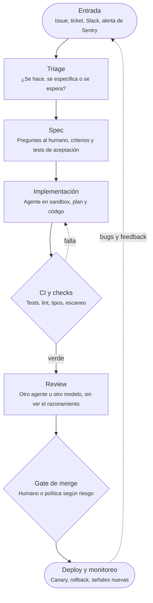
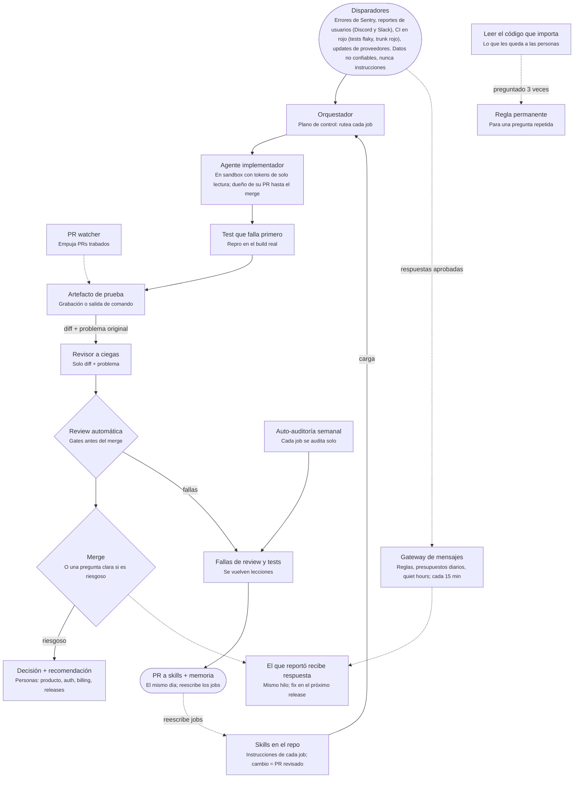
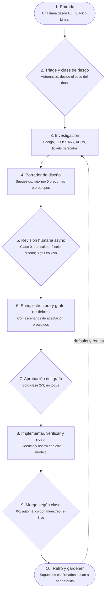
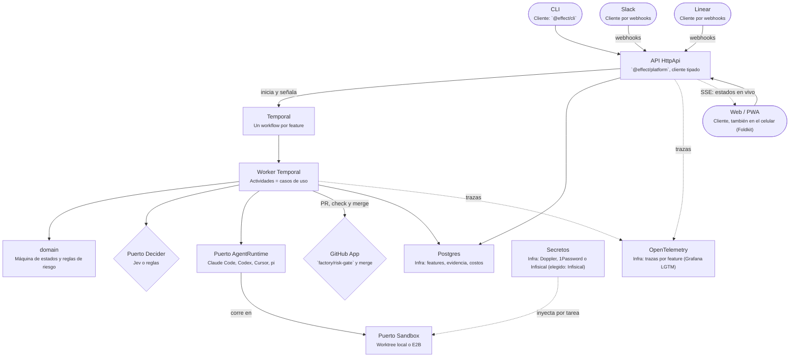

<!-- Exportado de https://cursor.com/canvas/store-5f96bc53-055f-46d9-9813-15e3171d2fa8/fbbbf96b-416b-4e19-b8d9-24d0efaa21de el 2026-11-07 -->

# Software factories: qué son y cómo se arman

> Los requerimientos de mi propia software factory (borrador v1) y la investigación detrás: qué hace la gente que arma fábricas con agentes de IA, cómo las arma, qué críticas hay y por dónde arrancar. Actualizado al 1 de noviembre de 2026.

## Índice

- [Software factories: qué son y cómo se arman](#software-factories-qué-son-y-cómo-se-arman)
  - [Índice](#índice)
  - [Resumen en una pantalla ](#resumen-en-una-pantalla-)
    - [Decisiones tomadas ](#decisiones-tomadas-)
    - [Próximo paso ](#próximo-paso-)
  - [Parte 1. Contexto: qué son las software factories ](#parte-1-contexto-qué-son-las-software-factories-)
    - [La idea en dos minutos ](#la-idea-en-dos-minutos-)
    - [Los niveles: de autocompletar a la fábrica oscura ](#los-niveles-de-autocompletar-a-la-fábrica-oscura-)
    - [Quiénes lo están haciendo ](#quiénes-lo-están-haciendo-)
    - [Cómo se arma una fábrica ](#cómo-se-arma-una-fábrica-)
    - [Comparativa de enfoques ](#comparativa-de-enfoques-)
    - [¿Qué es, en concreto? CLI, app, skills, dentro o fuera del repo ](#qué-es-en-concreto-cli-app-skills-dentro-o-fuera-del-repo-)
    - [Patrones que se repiten ](#patrones-que-se-repiten-)
    - [Lo que se dice en X ](#lo-que-se-dice-en-x-)
    - [Críticas y límites ](#críticas-y-límites-)
    - [Cómo empezar la tuya ](#cómo-empezar-la-tuya-)
    - [Traycer: cómo corre su factory ](#traycer-cómo-corre-su-factory-)
    - [Sandcastle (Matt Pocock) ](#sandcastle-matt-pocock-)
    - [Skill software-factory de Matt Pocock (in progress) ](#skill-software-factory-de-matt-pocock-in-progress-)
    - [Productos de referencia (no son base) ](#productos-de-referencia-no-son-base-)
  - [Parte 2. Mi factory: qué hace ](#parte-2-mi-factory-qué-hace-)
    - [Flujo de una feature nueva (de Pocock a la fábrica) ](#flujo-de-una-feature-nueva-de-pocock-a-la-fábrica-)
    - [Clases de riesgo y gate de merge ](#clases-de-riesgo-y-gate-de-merge-)
  - [Parte 3. Arquitectura y stack (v1, freelance) ](#parte-3-arquitectura-y-stack-v1-freelance-)
    - [Diagrama del sistema ](#diagrama-del-sistema-)
    - [Estructura del monorepo ](#estructura-del-monorepo-)
    - [Stack por capa ](#stack-por-capa-)
    - [Runtimes y sandboxes ](#runtimes-y-sandboxes-)
    - [Jev como Decider ](#jev-como-decider-)
    - [Clasificador de riesgo y merge ](#clasificador-de-riesgo-y-merge-)
    - [Global vs por repo: secretos, base de datos y telemetría ](#global-vs-por-repo-secretos-base-de-datos-y-telemetría-)
    - [Cómo se aplican los patrones que se repiten si la factory es global ](#cómo-se-aplican-los-patrones-que-se-repiten-si-la-factory-es-global-)
    - [Multi-tenant: para vos, tu laburo y cualquiera ](#multi-tenant-para-vos-tu-laburo-y-cualquiera-)
  - [Parte 4. Requerimientos (R-01 a R-94, más R-95 a R-109 y R-110 a R-121, y R-122) ](#parte-4-requerimientos-r-01-a-r-94-más-r-95-a-r-109-y-r-110-a-r-121-y-r-122-)
    - [Lo que pedí explícitamente (R-01 a R-08) ](#lo-que-pedí-explícitamente-r-01-a-r-08-)
    - [Núcleo del MVP (R-10 a R-22) ](#núcleo-del-mvp-r-10-a-r-22-)
    - [Auto-merge por riesgo (R-30 a R-35) ](#auto-merge-por-riesgo-r-30-a-r-35-)
    - [Fábrica como código, inspirado en Warp (R-40 a R-45) ](#fábrica-como-código-inspirado-en-warp-r-40-a-r-45-)
    - [Anti-slop, inspirado en poteto (R-50 a R-55) ](#anti-slop-inspirado-en-poteto-r-50-a-r-55-)
    - [Para más adelante (R-60 a R-67) ](#para-más-adelante-r-60-a-r-67-)
    - [Flujo de una feature nueva (R-70 a R-77) ](#flujo-de-una-feature-nueva-r-70-a-r-77-)
    - [Requerimientos nuevos de la arquitectura (R-78 a R-94) ](#requerimientos-nuevos-de-la-arquitectura-r-78-a-r-94-)
    - [Aprendido de Traycer y Sandcastle (R-95 a R-109) ](#aprendido-de-traycer-y-sandcastle-r-95-a-r-109-)
    - [Aprendido de la skill software-factory de Pocock (R-110 a R-121, más R-122 del plan de GitHub) ](#aprendido-de-la-skill-software-factory-de-pocock-r-110-a-r-121-más-r-122-del-plan-de-github-)
  - [Parte 5. Plan ](#parte-5-plan-)
    - [Decisiones abiertas (todas resueltas, salvo una nueva: plan de GitHub; Actualizado: resuelta, están todas resueltas) ](#decisiones-abiertas-todas-resueltas-salvo-una-nueva-plan-de-github-actualizado-resuelta-están-todas-resueltas-)
    - [Hoja de ruta ](#hoja-de-ruta-)
  - [Fuentes ](#fuentes-)
    - [Fuentes de los requerimientos ](#fuentes-de-los-requerimientos-)
    - [Fuentes de la investigación ](#fuentes-de-la-investigación-)

## Resumen en una pantalla 

> **Objetivo**: Una fábrica personal que toma trabajo desde CLI, Slack o Linear, lo pasa por spec, implementación, verificación y review con cualquier agente (Claude Code, Codex, Cursor, pi y otros), local o en la nube, y mergea sola solo lo que su clase de riesgo permite. Todo lo demás vuelve a mí con evidencia.

Cómo leer esta página: la Parte 1 es contexto (qué hacen los demás), la Parte 2 qué hace mi factory, la Parte 3 cómo está hecha, la Parte 4 junta todos los requerimientos y la Parte 5 tiene las decisiones y la hoja de ruta. Las fuentes están al final.

### Decisiones tomadas 

| Tema                           | Decisión                                                                                                                                                                                                                                                                                                                                                                       |
| ------------------------------ | ------------------------------------------------------------------------------------------------------------------------------------------------------------------------------------------------------------------------------------------------------------------------------------------------------------------------------------------------------------------------------ |
| Alcance v1                     | Solo mi trabajo freelance                                                                                                                                                                                                                                                                                                                                                      |
| Base                           | Construcción propia desde cero; productos existentes como referencia                                                                                                                                                                                                                                                                                                           |
| Lenguaje                       | TypeScript con Effect (lo quiero aprender)                                                                                                                                                                                                                                                                                                                                     |
| Motor de workflows             | Temporal, construido directo para Temporal, sin capa para migrar. Actualizado: ningún workflow espera a un humano (ver la fila Esperas humanas)                                                                                                                                                                                                                                |
| Diseño                         | Clean code, SOLID adaptado a Effect y arquitectura hexagonal                                                                                                                                                                                                                                                                                                                   |
| Agentes                        | Sin frameworks de agentes: el agente lo pone cada runtime y el orquestador es código determinístico                                                                                                                                                                                                                                                                            |
| Topología                      | Una factory global que atiende varios repos, y un `.factory/` en cada repo                                                                                                                                                                                                                                                                                                     |
| Distribución                   | Self-hosted primero (open source, con docker compose); SaaS más adelante                                                                                                                                                                                                                                                                                                       |
| Web                            | Foldkit. Antes era TanStack Start, que ahora queda como plan B si Foldkit se traba                                                                                                                                                                                                                                                                                             |
| Temporal                       | Autoalojado dentro del docker compose como default; Temporal Cloud como opción configurable                                                                                                                                                                                                                                                                                    |
| Sandbox local                  | git worktree primero; Docker después para agentes sin supervisión                                                                                                                                                                                                                                                                                                              |
| Secretos                       | Infisical autoalojado, detrás de un puerto `SecretStore`                                                                                                                                                                                                                                                                                                                       |
| Telemetría                     | Grafana stack LGTM (Loki, Grafana, Tempo, Mimir) autoalojado con la imagen `grafana/otel-lgtm`                                                                                                                                                                                                                                                                                 |
| Despliegue de mi instancia     | Un VPS (Hetzner, DigitalOcean, etc.) con el mismo docker compose                                                                                                                                                                                                                                                                                                               |
| Esperas humanas (nuevo)        | Ninguna run espera a un humano: el workflow deja un comentario o label en Linear o en el PR y termina; el cambio humano dispara un workflow nuevo que reconstruye el contexto desde Linear y GitHub. Temporal sigue para reintentos, timeouts, durabilidad, corridas largas de agentes y heartbeats, pero sin signals de aprobación de larga duración (R-110)                  |
| Plan de GitHub y merge (nuevo) | Sin GitHub Pro por ahora: solo la GitHub App de la factory mergea, después de consultar `factory/risk-gate`; ningún agente tiene permiso de merge. El risk-gate es un status check normal, listo para hacerlo obligatorio con un ruleset. Aviso por Slack de cualquier PR mergeado sin risk-gate en verde (R-122). Paso a Pro o Team cuando sume personas o un cliente lo pida |

SOLID en Effect se ve distinto que en Java: servicios chicos, funciones puras y sin herencia. La hexagonal sale casi sola con `Layer` y `Context`, que ya son inyección de dependencias con puertos y adaptadores. Las reglas de riesgo y la lógica de cada paso quedan en el dominio puro, por la hexagonal y no para una migración futura.

Alternativas descartadas:

- Inngest: el más fácil de arrancar, pero el servicio gestionado se paga por volumen y hostearlo uno mismo es poco común.
- Trigger.dev: open source y más simple de operar; es la alternativa razonable si Temporal se vuelve pesado.
- `@effect/workflow`: coherente con Effect, pero todavía es unstable y tiene poca documentación.

Por qué cada elección de infraestructura, con sus alternativas:

| Elegido                                                                                         | A favor y en contra                                                                                                                                                                                                                                                                                                                                   | Alternativas                                                                                                                                                                                                                                  |
| ----------------------------------------------------------------------------------------------- | ----------------------------------------------------------------------------------------------------------------------------------------------------------------------------------------------------------------------------------------------------------------------------------------------------------------------------------------------------- | --------------------------------------------------------------------------------------------------------------------------------------------------------------------------------------------------------------------------------------------- |
| Web: Foldkit (elegido)                                                                          | Effect de punta a punta, The Elm Architecture, Subscriptions para el SSE y transiciones testeables. Contra: pre-1.0, comunidad chica y no es React (detalle debajo)                                                                                                                                                                                   | TanStack Start como plan B si Foldkit se traba (fila siguiente); Next.js descartado                                                                                                                                                           |
| Web: TanStack Start (ahora plan B si Foldkit se traba)                                          | Más liviano, tipado de punta a punta y encaja con Effect. Contra: menos maduro                                                                                                                                                                                                                                                                        | Next.js, descartado: más ejemplos y deploy fácil en Vercel, pero RSC y caché agregan complejidad, chocan con Effect y fuera de Vercel cuesta más                                                                                              |
| Temporal autoalojado en el docker compose (default)                                             | Gratis y coherente con self-hosted. Contra: lo operás vos                                                                                                                                                                                                                                                                                             | Temporal Cloud, como opción configurable: cero mantenimiento, pero pago y dependencia externa. Es el mismo código; cambia la dirección a la que se conecta el worker. Esto resuelve la inconsistencia entre "Temporal Cloud" del stack y R-94 |
| Sandbox local: git worktree primero                                                             | Instantáneo y liviano; lo usan Claude Code, bb y herdr. Contra: no aísla de verdad                                                                                                                                                                                                                                                                    | Docker después, para agentes sin supervisión: aislamiento real y límites de red y recursos. Contra: más lento y requiere Docker                                                                                                               |
| Secretos: Infisical, detrás del puerto `SecretStore`                                            | Open source, autoalojable en el compose, con SDK y CLI por proyecto y entorno. Contra: otro servicio que operar y un ecosistema más chico                                                                                                                                                                                                             | Enchufables: 1Password (no es self-hosted, es pago y está pensado para personas) y Doppler (solo SaaS, por usuario)                                                                                                                           |
| Telemetría: Grafana stack LGTM autoalojado (`grafana/otel-lgtm`)                                | Open source y todo en uno. Contra: más trabajo de dashboards y operación                                                                                                                                                                                                                                                                              | Honeycomb (mejor exploración de trazas, SaaS) y Axiom (barato, SaaS), vía OTel cambiando una variable                                                                                                                                         |
| Despliegue: un VPS con el mismo docker compose                                                  | Barato, y prueba mi propia distribución. Contra: el mantenimiento es mío                                                                                                                                                                                                                                                                              | Fly.io + Neon y Railway + Supabase, descartados: dos formas de desplegar, Temporal autoalojado incómodo y costos                                                                                                                              |
| Esperas humanas: ninguna run espera a un humano (nuevo, de la skill software-factory de Pocock) | A favor: el estado queda visible y editable en Linear y GitHub; evita el problema de versionar workflows pausados durante días; los workflows quedan cortos, testeables y reintentables. Contra: cada workflow tiene que reconstruir el contexto desde Linear y GitHub, y hace falta deduplicación e idempotencia (R-113)                             | Workflows de Temporal que esperan con signals de aprobación de larga duración (lo que describía antes el flujo en los pasos 5, 7 y 9): queda descartado para esperas humanas, Temporal sigue para lo demás                                    |
| Merge: solo la GitHub App mergea, sin GitHub Pro por ahora (nuevo)                              | A favor: gratis, y ya encaja con R-82 (la App como única identidad que mergea) y R-100 (tokens de solo lectura en los sandboxes). Contra: es una regla de la factory, no de GitHub; un humano con write puede mergear a mano saltándose el gate, y no protege contra un bug de la App. Se mitiga con el aviso de merge sin risk-gate en verde (R-122) | GitHub Pro o Team con ruleset obligatorio (queda para cuando sume otras personas o un cliente lo pida); branch protection clásica; repos públicos                                                                                             |

Foldkit, el framework web elegido (https://foldkit.dev/): es un framework de frontend en TypeScript sobre Effect que sigue The Elm Architecture. Tiene un solo Model definido con Schema, Messages tipados, un update puro que devuelve el Model nuevo más Commands (efectos como datos que ejecuta el runtime) y una view que sale del estado. Trae routing, SSR y prerender, componentes headless accesibles, DevTools, dos frameworks de test y un scaffolder. Es una SPA, opcionalmente prerenderizada o con SSR, y todavía es pre-1.0. Fuente: https://foldkit.dev/about

**A favor de Foldkit**

- ✅ Effect de punta a punta: comparte los Schemas con la API `HttpApi`
- ✅ Las Subscriptions convierten el stream SSE de estados en Messages, con un ciclo de vida atado al Model
- ✅ Las transiciones viven en update, así que son testeables y trazables
- ✅ Está pensado para que equipos y agentes de IA lo modifiquen con convenciones compartidas
- ✅ Las server functions de TanStack Start no hacían falta, porque el backend es una API Effect aparte

**En contra de Foldkit**

- ❌ Es pre-1.0: las versiones menores pueden cambiar la API
- ❌ Comunidad chica, y los modelos de IA lo conocen menos que a React
- ❌ No es React: no comparte componentes con una app mobile en React Native (sí los Schemas y el cliente de la API)
- ❌ Suma aprender The Elm Architecture junto con Effect; lo mitiga mi experiencia en programación funcional y Haskell

Queda como detalle a definir en su spec: si el adaptador de Codex usa `codex exec` o el SDK de TypeScript.

> **Trabajo en relación de dependencia** (info): Queda para después. El camino es una instalación self-hosted de la misma factory, aprobada por la empresa y corriendo en su infraestructura, con sus keys de IA. Así su código nunca pasa por mi infra personal.

### Próximo paso 

La Fase 0 (estudiar referencias) es opcional y corta; después arranca la Fase 1, el MVP. El detalle de cada fase está en la Parte 5, Hoja de ruta.

Escribir el primer spec: Modelo de dominio de features.

## Parte 1. Contexto: qué son las software factories 

Qué es una software factory, quién las está armando y cómo, qué patrones se repiten, qué críticas hay y qué productos sirven como referencia.

### La idea en dos minutos 

Una software factory es un sistema donde agentes de IA toman trabajo de una cola (issues, tickets, alertas), escriben el código, lo testean y abren un PR, mientras las personas deciden qué se construye y qué se mergea. No es "un agente más inteligente": son muchos loops de agentes, cada uno con su rol, encadenados en un pipeline.

Addy Osmani lo resume en tres capas: el loop (un agente haciendo una tarea hasta que un check pasa), el harness (el sandbox, las herramientas, la memoria y los gates que definen "terminado") y la fábrica (muchos loops con harness, alimentados por una cola y drenados por un gate de review). Fuente: https://www.oreilly.com/radar/software-factories-light-and-dark/

La gran división es cuánto revisan los humanos. En una fábrica "light" los agentes construyen y una persona revisa y mergea. En una "dark factory" el código sale a producción sin que ningún humano lo lea, verificado solo por otras máquinas.

> **La clave**: El cuello de botella dejó de ser escribir código. Ahora es verificarlo: especificar bien, testear de forma que el agente no pueda hacer trampa y decidir cuánta autonomía darle a cada tipo de cambio.

### Los niveles: de autocompletar a la fábrica oscura 

| Nivel                        | Qué hace el humano                                              | Ejemplo                             |
| ---------------------------- | --------------------------------------------------------------- | ----------------------------------- |
| 0. Autocompletar picante     | Escribe todo, la IA sugiere                                     | Copilot original, copiar de ChatGPT |
| 1. Pasante                   | Delega tareas chicas (un test, un docstring)                    | Chat en el IDE                      |
| 2. Junior / pair programming | Programa a la par con la IA y revisa cada línea                 | Cursor, Claude Code interactivo     |
| 3. Manager                   | Revisa diffs de varios agentes en paralelo                      | Varias sesiones con worktrees       |
| 4. Product manager           | Escribe specs, planes y skills; vuelve a ver si pasan los tests | Agentes largos con harness robusto  |
| 5. Dark factory              | Diseña la fábrica; nadie escribe ni revisa código               | StrongDM                            |

La escala es de Dan Shapiro (enero 2026), inspirada en los niveles de autonomía de los autos. Según él, el 90% de los devs "AI-native" está en nivel 2 y casi todos topan en el 3. Él se ubica en el 4. Fuente: https://www.danshapiro.com/blog/2026/01/the-five-levels-from-spicy-autocomplete-to-the-software-factory/

Esta escala se volvió el vocabulario común: la citan en X equipos como OpenAlgo ("estamos en nivel 4, yendo al 5") y la usan talleres como el de GlassFlow en Múnich.

### Quiénes lo están haciendo 

| Quién                                    | Qué hizo                                                                                                | Resultado que reportan                                                           |
| ---------------------------------------- | ------------------------------------------------------------------------------------------------------- | -------------------------------------------------------------------------------- |
| StrongDM (Justin McCarthy y equipo de 3) | Fábrica dark desde julio 2025. Reglas: el código no lo escriben ni lo revisan humanos                   | Varios productos en producción, entre ellos CXDB (unas 32 mil líneas Rust/Go/TS) |
| Steve Yegge – Gas Town                   | Orquestador open source para 20 a 30 instancias de Claude Code con roles (Mayor, Polecats, Refinery)    | Su cuarto orquestador de 2025; maneja merge queue entre agentes                  |
| Geoffrey Huntley – Ralph y Loom          | Ralph: un loop de bash que repite el agente con contexto fresco. Loom: orquestador de loops             | Lo usa para portar software y clonar productos                                   |
| Tessl – Kikimora                         | Fábrica interna: tickets de Linear, sandboxes aislados, auto-merge si pasan los checks                  | Pico de 850 PRs en una semana, 85 a 90% manejados de punta a punta por agentes   |
| Warp – Warp Factories                    | Infraestructura (beta cerrada, ago 2026): triage, spec, implementación, review, verificación, monitoreo | Warp automatiza cerca del 30% de sus propias tareas                              |
| Vercel – Foreman (eve)                   | Template de 4 subagentes: clasificador, analista, implementador y revisor de otro proveedor de modelo   | Termina en un PR borrador; un humano mergea                                      |
| Factory (Droids)                         | Agentes que hacen spec, código, tests, review y deploy para empresas                                    | USD 150M a 1.500M de valuación (abr 2026) y USD 200M a 5.000M (sep 2026)         |
| OpenAlgo (open source, India)            | Claude Code + Codex escriben, revisan PRs y mergean; humanos hacen specs y prueban con brokers reales   | De 25 a 312 contribuciones por semana, según ellos                               |

Ojo: casi todas estas cifras son autorreportadas por las mismas empresas o personas. Un relevamiento de Astrohacker advierte que la mayoría de las fuentes son blogs de vendors y que algunos números se contradicen entre sí.

### Cómo se arma una fábrica 

_Nodos del diagrama:_

- **Entrada**: Issue, ticket, Slack, alerta de Sentry (terminal)
- **Triage**: ¿Se hace, se especifica o se espera?
- **Spec**: Preguntas al humano, criterios y tests de aceptación
- **Implementación**: Agente en sandbox, plan y código
- **CI y checks**: Tests, lint, tipos, escaneo (decision)
- **Review**: Otro agente u otro modelo, sin ver el razonamiento
- **Gate de merge**: Humano o política según riesgo (decision)
- **Deploy y monitoreo**: Canary, rollback, señales nuevas (terminal)

_Relaciones:_

- Entrada → Triage
- Triage → Spec
- Spec → Implementación
- Implementación → CI y checks
- CI y checks → Implementación (falla) [punteada]
- CI y checks → Review (verde)
- Review → Gate de merge
- Gate de merge → Deploy y monitoreo
- Deploy y monitoreo → Entrada (bugs y feedback) [punteada]

Este es el pipeline típico que describen Warp, Vercel y Tim de Pater. Lo que más se repite en los diseños serios:

1. El orquestador no es un agente: es código determinístico (una máquina de estados por issue) que decide el próximo paso. Así el ruteo, los límites y el botón de apagado no se pueden "convencer".
2. Un contenedor nuevo por tarea: checkout limpio, sin estado previo, y se destruye al terminar.
3. Cada rol es configuración, no código: prompt, modelo, herramientas permitidas, rutas que puede tocar, presupuesto en turnos y dólares, y un schema de salida.
4. El agente nunca tiene el token de Git: el worker decide qué se commitea y abre el PR.
5. El revisor usa otro modelo y no ve el plan ni el transcript del implementador.
6. Los tests de aceptación los escribe el rol de spec y están protegidos, así el implementador no los puede cambiar para que pasen.

Detalle completo y con costos (menos de 10 euros al mes en reposo, en Google Cloud): https://timdepater.com/articles/blueprint-for-a-dark-factory/

### Comparativa de enfoques 

| Enfoque                  | Orquestación                                            | Verificación                                                | Humano                                       |
| ------------------------ | ------------------------------------------------------- | ----------------------------------------------------------- | -------------------------------------------- |
| Ralph loop (Huntley)     | Un loop de bash, una tarea por vuelta, contexto fresco  | Tests y compilación estricta                                | Escribe specs y el PROMPT.md                 |
| Gas Town (Yegge)         | Jerarquía de agentes con roles, mailboxes y merge queue | Refinery: rebase, checks y merge                            | El "Overseer", habla con el Mayor            |
| StrongDM / Attractor     | Grafo de nodos con prompts, corre hasta converger       | Escenarios ocultos + gemelos digitales de Okta, Slack, Jira | Specs, escenarios y políticas; no lee código |
| Tim de Pater (blueprint) | Máquina de estados determinística + Cloud Run Jobs      | Tests de aceptación protegidos, review con otro modelo      | Contesta preguntas y mergea                  |
| Vercel Foreman           | 4 subagentes en orden fijo                              | Revisor de otro vendor, hasta 2 ciclos                      | Marca el PR listo y mergea                   |
| Warp Factories           | Agente "foreman" que reparte a subagentes               | Computer use, evals y scorers                               | Interviene en puntos de decisión             |

### ¿Qué es, en concreto? CLI, app, skills, dentro o fuera del repo 

Respuesta corta: casi nunca es un producto solo. Es un orquestador que corre afuera del repo (un CLI en tu máquina, un servicio en la nube o un SaaS) más un conjunto de archivos versionados que le dicen a los agentes qué hacer. A veces esos archivos viven en el mismo repo y a veces en un repo aparte de la fábrica.

| Caso                      | Forma del producto                                                                        | Qué vive en el repo                                                                                             | Qué corre afuera                                                                                                                                        |
| ------------------------- | ----------------------------------------------------------------------------------------- | --------------------------------------------------------------------------------------------------------------- | ------------------------------------------------------------------------------------------------------------------------------------------------------- |
| Ralph loop (Huntley)      | Un script de bash (`loop.sh`) que llama a `claude -p` una y otra vez                      | Todo: `loop.sh`, `PROMPT_build.md`, `AGENTS.md`, `specs/*.md`, `IMPLEMENTATION_PLAN.md`                         | Nada, salvo el CLI del agente en tu máquina o un contenedor                                                                                             |
| Gas Town (Yegge)          | CLI en Go (`gt`) más el tracker `bd` (Beads), corre local con tmux                        | Tu repo queda casi intacto; Gas Town lo clona como "rig" con worktrees por worker                               | Un "town" aparte (`~/gt`) con su `CLAUDE.md`, roles, `.beads/` y un daemon que coordina 20 a 30 agentes                                                 |
| StrongDM / Attractor      | Sistema interno propio; publicaron solo specs en markdown para que tu agente lo construya | Specs (NLSpecs) y pipelines como grafos en archivos `.dot` versionables                                         | El motor que recorre el grafo, escenarios ocultos fuera del código, gemelos digitales de Okta, Slack, etc., y CXDB para el contexto                     |
| Tim de Pater (blueprint)  | Servicio propio en Google Cloud armado con Terraform                                      | Tests de aceptación, `CLAUDE.md`, carpeta `intent/` con specs y planes (rutas protegidas para el implementador) | Orquestador en Cloud Run, un Cloud Run Job por rol, Pub/Sub, Firestore, Secret Manager                                                                  |
| Vercel Foreman (eve)      | App que deployás en Vercel desde un template; repo propio de la fábrica                   | Nada obligatorio; solo apuntás `FACTORY_REPO` y una label `factory` en los issues                               | Repo de la fábrica con `agent/` (subagentes, skills, evals), sandboxes de Vercel, Blob como memoria, GitHub App                                         |
| Warp Factories            | SaaS e infraestructura (beta) con control room web, CLI y Factory MCP                     | Lo que use tu código (skills, convenciones)                                                                     | "Terraform para agentes": `factory.yaml` con `agents/`, `automations/`, `skills/`, `runners/`, `scorers/`, versionado aparte y aplicable a varios repos |
| Tessl (Kikimora)          | Web app, CLI `tessl` y un registry de skills; los agentes corren en la nube de Tessl      | Skills y reglas instaladas con `tessl install`, más `tessl.json`                                                | Las automatizaciones que toman tickets de Linear o GitHub y corren el plugin `factory` (implement, shepherd, merge-conflict-sweep)                      |
| Factory (Droids)          | SaaS con CLI `droid`, modo headless `droid exec`, apps de Slack y Linear                  | Workflows de GitHub Actions que se agregan con un PR de setup, prompts como `.github/prompts/*.md`              | Computadoras remotas de Factory, cuentas de servicio, delegación desde Slack y Linear                                                                   |
| GitHub Agentic Workflows  | Extensión `gh aw` del CLI de GitHub; corre sobre GitHub Actions                           | Archivos markdown en `.github/workflows/` compilados a `.lock.yml`, más skills que agrega `gh aw init`          | Los runners de GitHub Actions y el motor elegido (Copilot, Claude Code, Codex, Gemini)                                                                  |
| Claude Code GitHub Action | Una Action (`anthropics/claude-code-action`) que responde a `@claude`                     | `.github/workflows/claude.yml` y `CLAUDE.md` con reglas del proyecto                                            | Runners de GitHub y la API de Anthropic                                                                                                                 |

El patrón general: dentro del repo vive lo que describe el producto y cómo se trabaja en él (specs, `AGENTS.md` o `CLAUDE.md`, skills, tests, workflows de CI). Afuera vive lo que coordina y aísla: la cola, el orquestador, los sandboxes, la memoria, los tokens y el dashboard. Los esquemas más chicos (Ralph, GitHub Actions) entran enteros en el repo. Los que manejan varios repos (Gas Town, Warp, Foreman, de Pater) tienen su propio repo o servicio de fábrica que apunta a los demás.

- [The Ralph Playbook (loop.sh, PROMPT.md, specs)](https://github.com/ghuntley/how-to-ralph-wiggum) — GitHub
- [Installing Gas Town](https://github.com/gastownhall/gastown/blob/main/docs/INSTALLING.md) — GitHub
- [Attractor (NLSpecs y pipelines .dot)](https://github.com/strongdm/attractor) — GitHub / StrongDM
- [A blueprint for a dark factory](https://timdepater.com/articles/blueprint-for-a-dark-factory/) — Tim de Pater
- [Build a software factory with eve](https://vercel.com/kb/guide/eve-software-factory) — Vercel
- [Terraform for agents: how we define our software factory in code](https://www.warp.dev/blog/software-factory-as-code) — Warp
- [Plugin factory de Tessl](https://tessl.io/registry/tessl-labs/factory) — Tessl Registry
- [Tessl CLI](https://docs.tessl.io/reference/cli-commands) — Tessl Docs
- [Droid Exec (headless)](https://docs.factory.com/droid-exec/overview) — Factory Docs
- [Custom Automations](https://docs.factory.com/automations/custom) — Factory Docs
- [Creating GitHub Agentic Workflows](https://docs.github.com/en/copilot/how-tos/github-agentic-workflows/creating-github-agentic-workflows) — GitHub Docs
- [Claude Code GitHub Actions](https://code.claude.com/docs/en/github-actions) — Claude Code Docs

### Patrones que se repiten 

1. Escenarios como holdout: StrongDM guarda historias de usuario fuera del repo, para que el agente no pueda "estudiar para el examen", y mide satisfacción (qué fracción de recorridos satisface al usuario) en vez de verde o rojo.
2. Gemelos digitales: clones de APIs externas para testear miles de escenarios por hora sin límites de rate ni costos.
3. Skills antes que loops: Tessl dice que el paso que no se puede saltear es escribir qué es "bueno" en tu código; recién después se automatiza.
4. Verificadores baratos: chequeos chicos tipo LLM-as-judge generados desde una skill que corren en CI, porque "los agentes no tienen por qué seguir un markdown".
5. Autonomía por riesgo: clases de 0 (docs) a 3 (auth, pagos, infra). Solo las bajas se mergean solas, y un incidente devuelve la clase a revisión humana.
6. Reglas que emergen: cuando un agente se va de mambo, eso es la señal para escribir una regla nueva (taller de AI Engineer).
7. Auto-mejora del harness: agentes observadores que puntúan corridas y abren PRs para mejorar prompts, skills o elección de modelo (Warp).
8. Loops chicos que se ganan la oscuridad: por ejemplo un cron nocturno que arregla un solo anti-patrón y abre un PR corto (Dex Horthy).

Cómo bajan estos patrones a mi factory, que es global y atiende varios repos: ver "Cómo se aplican los patrones que se repiten si la factory es global", en Arquitectura y stack.

Agregado (Traycer): la factory que mejora sus propios jobs, con auto-auditoría semanal y lecciones que vuelven a skills y memoria; ver Traycer: cómo corre su factory, y R-106 y R-107.

### Lo que se dice en X 

> Todos hablan de ir más rápido con agentes. Eso es facilísimo: loops, modo YOLO, dark factory. Es la receta para un cañón de slop. Ninguna organización seria va a confiar en una fábrica así. Hay que frenar para acelerar.
>
> — Matt Pocock, 28 oct 2026 – x.com/mattpocockuk/status/2115538750147023323

> Una software factory no es una dark factory. La luz en la fábrica son los humanos con buenas ideas. Lo que queda a oscuras es la plomería: qué modelo está en el frente de Pareto esta semana, cómo se cablea el workflow, cómo corre la validación.
>
> — Adam Huda (Uber), 15 oct 2026 – x.com/hudaman/status/2110568701162631627

> Cerca del 96% de nuestro desarrollo sigue un modelo de software factory con Claude Code y Codex. Los agentes escriben código, revisan PRs y mergean. Los humanos se ocupan de producto, specs y pruebas con brokers reales.
>
> — Marketcalls / OpenAlgo, 31 oct 2026 – x.com/marketcallsHQ/status/2116595037505216933

> La mayoría de los pitches de software factory te venden la etapa tres. Los que duran son los que te hacen ganarte la etapa dos primero.
>
> — Vinci Rufus, 16 sep 2026 – x.com/Areai51/status/2100265297928245657

Otro post útil: el taller de GlassFlow en Múnich (orquestador, builder y reviewer con Claude Code, cada builder en su worktree, un hook que solo deja pushear al reviewer). GlassFlow corre nivel 4 internamente y nivel 5 solo para triage de bugs: x.com/DrFloSteiner/status/2116092776110502216

### Críticas y límites 

**Lo que se gana**

- ✅ Mucho más throughput en trabajo acotado y verificable
- ✅ Tareas de backlog que nunca se hacían (consistencia, copy, deuda chica)
- ✅ Gente no técnica puede mandar tickets o editar código
- ✅ Visibilidad y gobierno al pasar de laptops a workflows en la nube

**Lo que se arriesga**

- ❌ Deuda de comprensión: crece el código que nadie entiende, con los tests en verde
- ❌ Agentes que hacen trampa con los tests que pueden ver
- ❌ Costo alto: StrongDM sugiere gastar USD 1.000 por día en tokens por ingeniero
- ❌ Seguridad: agentes con credenciales de más pueden romper producción
- ❌ Responsabilidad legal difusa cuando nadie leyó el código

Dex Horthy (HumanLayer) corrió una fábrica completamente automática unos cuatro meses y concluyó que falla: los modelos están entrenados para pasar tests, no para mantener buena arquitectura a largo plazo. Su receta es poner el juicio humano antes (producto, arquitectura, plan) y seguir revisando código. Charla: https://ai.engineer/talks/harness-engineering-is-not-enough-why-software-factories-fail

Osmani lo llama "back pressure": a un loop solo le podés dar tanta autonomía como puedas verificar barato y de forma confiable. La generación es una boca ancha y la verificación un cuello angosto.

Del lado de seguridad, la arquitectura de referencia de Agent Baseline cita el incidente de PocketOS: un agente en una tarea de staging encontró un token en un archivo, lo usó y borró la base de producción y sus backups en nueve segundos. La conclusión: los límites se imponen fuera del agente (sandbox, red, identidad), no en el prompt. https://agentbaseline.org/software-factory.pdf

La síntesis de darkfactory.dev cita un estudio donde el 94% de los devs no detectó una exfiltración de datos plantada en un cambio, y el 56% la mergeó incluso con una alerta correcta: la aprobación humana se degrada con el volumen. https://darkfactory.dev/factory

> **Para leer con pinzas** (warning): Los números de productividad casi siempre vienen de quien vende o promociona la fábrica, y todavía hay poca evidencia de mantenimiento a largo plazo, defectos escapados o incidentes.

### Cómo empezar la tuya 

1. **Ordená el repo para agentes**: Tipos estrictos, tests rápidos, módulos con límites claros y un `AGENTS.md` o `CLAUDE.md` con comandos y convenciones. Esa arquitectura de siempre es la red de seguridad más barata.
2. **Escribí tus skills**: Qué es código bueno en tu proyecto, cómo se revisa, qué no se toca. Sin esto, cualquier automatización se estanca (lección de Tessl).
3. **Corré un Ralph loop chico**: Un `while` que llama a Claude Code o Codex en modo no interactivo con un `PROMPT.md`, una tarea por vuelta y un plan que el agente actualiza. Guía: github.com/ghuntley/how-to-ralph-wiggum
4. **Separá roles**: Spec que escribe tests de aceptación que el implementador no puede tocar, implementador en un worktree o contenedor propio, y revisor con otro modelo que no ve el plan.
5. **Armá un orquestador simple y determinístico**: Una máquina de estados que escuche webhooks de GitHub o Linear y lance un worker por tarea, con presupuesto de turnos y dólares.
6. **Medí antes de soltar**: Evals por rol con tareas reales de resultado conocido. Hacé correr la review automática al lado de la tuya y mirá cuánto coinciden.
7. **Dale autonomía por clase de riesgo**: Docs y lint primero; auth, pagos e infra siempre con humano. Un incidente vuelve la clase atrás.
8. **O usá una plataforma**: Si no querés armar la infra: el template Foreman de Vercel, Warp Factories o Gas Town como punto de partida.

Un primer loop seguro y útil: un cron nocturno que arregla un solo tipo de warning de lint y abre un PR chico para que lo revises a la mañana.

### Traycer: cómo corre su factory 

Pranshu Gupta (@pranshgupta54), de Traycer, contó en X cómo funciona su factory y publicó un diagrama, "how our software factory runs". Fuente: https://x.com/pranshgupta54/status/2117232219886678236

- Harness y sandboxes: un plano de control central rutea cada job, y los agentes corren en otro lado, en sandboxes, con tokens de solo lectura.
- Corridas durables: el agente que abre un PR es su dueño hasta el merge, y un chequeo mira los PRs abiertos de la factory y empuja los que están trabados.
- Skills como agentes: las instrucciones de cada job viven como skills en el repo, así que cambiar la factory es un PR revisado como cualquier otro código.
- Review: un revisor a ciegas lee solo el diff y el problema original, para que no lo puedan convencer de estar de acuerdo. Ningún fix entra sin un test que falla en el código viejo.
- Humanos en el loop: las personas deciden producto, auth, facturación, releases y respuestas públicas; cada una llega como una decisión con una recomendación.
- Auto-mejora, lo que más usan: las reviews y tests fallidos alimentan skills y memoria, y cada job se audita solo cada semana.

_Nodos del diagrama:_

- **Disparadores**: Errores de Sentry, reportes de usuarios (Discord y Slack), CI en rojo (tests flaky, trunk rojo), updates de proveedores. Datos no confiables, nunca instrucciones (terminal)
- **Orquestador**: Plano de control: rutea cada job
- **Skills en el repo**: Instrucciones de cada job; cambio = PR revisado
- **PR watcher**: Empuja PRs trabados
- **Agente implementador**: En sandbox con tokens de solo lectura; dueño de su PR hasta el merge
- **Test que falla primero**: Repro en el build real
- **Artefacto de prueba**: Grabación o salida de comando
- **Revisor a ciegas**: Solo diff + problema
- **Review automática**: Gates antes del merge (decision)
- **Merge**: O una pregunta clara si es riesgoso (decision)
- **Decisión + recomendación**: Personas: producto, auth, billing, releases (person)
- **Gateway de mensajes**: Reglas, presupuestos diarios, quiet hours; cada 15 min
- **El que reportó recibe respuesta**: Mismo hilo; fix en el próximo release
- **Leer el código que importa**: Lo que les queda a las personas (person)
- **Regla permanente**: Para una pregunta repetida
- **Auto-auditoría semanal**: Cada job se audita solo
- **Fallas de review y tests**: Se vuelven lecciones
- **PR a skills + memoria**: El mismo día; reescribe los jobs (terminal)

_Relaciones:_

- Disparadores → Orquestador
- Skills en el repo → Orquestador (carga)
- Orquestador → Agente implementador
- Agente implementador → Test que falla primero
- Test que falla primero → Artefacto de prueba
- PR watcher → Artefacto de prueba [punteada]
- Artefacto de prueba → Revisor a ciegas (diff + problema original)
- Revisor a ciegas → Review automática
- Review automática → Merge
- Merge → Decisión + recomendación (riesgoso)
- Disparadores → Gateway de mensajes (respuestas aprobadas) [punteada]
- Gateway de mensajes → El que reportó recibe respuesta [punteada]
- Merge → El que reportó recibe respuesta [punteada]
- Leer el código que importa → Regla permanente (preguntado 3 veces) [punteada]
- Review automática → Fallas de review y tests (fallas)
- Auto-auditoría semanal → Fallas de review y tests
- Fallas de review y tests → PR a skills + memoria
- PR a skills + memoria → Skills en el repo (reescribe jobs) [punteada]

Recreación del diagrama del post. Las líneas punteadas son chequeos, respuestas y resultados, y el ciclo de fallas, lecciones y PR a skills es el loop de auto-mejora.

> we run a software factory and most of this list maps onto ours. harness + sandboxes: a central control plane routes each job and the agents run elsewhere in sandboxes. they only hold read tokens. durable runs: the agent that opens a PR owns it to merge. a check looks at the factory's open PRs and nudges anything stuck. skills as agents: every job's instructions live as skills in the repo, so changing the factory is a reviewed PR like any other code. review: a separate blind reviewer reads only the diff and the original problem so it can't be talked into agreeing. no fix lands without a test that fails on the old code. HITL: people own product calls, auth, billing, releases and public replies. each one shows up as a decision with a recommendation. the part we lean on hardest at Traycer is the factory improving its own jobs. failed reviews and tests feed back into skills and memory, every job audits itself weekly and 43 of its first 332 merged PRs were it improving itself
>
> — Pranshu Gupta (@pranshgupta54), Traycer – x.com/pranshgupta54/status/2117232219886678236

> **Cifra declarada** (warning): Lo de 43 de sus primeros 332 PRs mergeados como auto-mejora lo declara Traycer; no está verificado.

Lo que tomo de acá está en la Parte 4, en Aprendido de Traycer y Sandcastle (R-95 a R-109).

### Sandcastle (Matt Pocock) 

Matt Pocock (@mattpocockuk) presentó Sandcastle v1, una herramienta para construir tu propia software factory. Fuente: https://x.com/mattpocockuk/status/2116805878187794740

- 6 harnesses integrados (Claude Code, Codex y otros), o el tuyo.
- Se integra con proveedores de sandbox: Daytona, Vercel, E2B y otros.
- Plantillas con Inngest o Trigger.dev para una factory durable.
- Humano en el loop por Slack y Discord, y corridas AFK (sin nadie mirando).
- Cada skill del repo se vuelve un `Agent()`, una función invocable: `CodeReview()`, `ImplementSpec()`, `Retro()`, `ImproveCodebaseArchitecture()`.
- Defaults opinados basados en mattpocock/skills, extensible, y corre en tu infra.

Para mi factory es referencia, no base: lo que más me sirve es la idea de skills como funciones invocables (R-108). Sus plantillas usan Inngest o Trigger.dev; yo elegí Temporal.

### Skill software-factory de Matt Pocock (in progress) 

Qué es: una skill en progreso del repo mattpocock/skills (último cambio el 31 oct 2026) que no es un producto sino una referencia. Trae un vocabulario compartido para diseñar una software factory, un método de diseño, un catálogo de tasks de ejemplo agrupadas por el problema que resuelven, relevamientos de los productos que llenan cada slot (ticket trackers, git hosts, runners, plataformas de observabilidad) y las preguntas que cierran un diseño. Es de invocación manual: el modelo no la llama solo (`disable-model-invocation: true`), y según el README y el changeset del repo se usa junto con una sesión de grilling. Fuente: https://github.com/mattpocock/skills/tree/main/skills/in-progress/software-factory

> Una software factory es un sistema de agentes que convierte tickets, PRs y horarios en código mergeado, desplegado en la infraestructura remota que elige el usuario.

Vocabulario, con los términos que la skill pide evitar:

| Término                | Qué es                                                                                                                                                                                                                                                                            | Evitar                                       |
| ---------------------- | --------------------------------------------------------------------------------------------------------------------------------------------------------------------------------------------------------------------------------------------------------------------------------- | -------------------------------------------- |
| Task                   | Un tipo de trabajo que se define una vez y corre muchas veces (review, explore, implement, ratchet). Trabaja sobre un ticket, un PR o el codebase                                                                                                                                 | job, workflow, action                        |
| Trigger                | El evento que arranca una run: un cambio en el ticket tracker o en el git host, un reloj del orchestrator u otra run                                                                                                                                                              | (no indica)                                  |
| Run                    | Una ejecución de una task en un runner, de punta a punta, tratada como caja negra. Puede disparar otras runs directo, por el orchestrator o cambiando el tracker o el git host. Una run nunca espera a un humano: termina, y el cambio posterior del humano dispara una run nueva | session                                      |
| Runner                 | La máquina descartable donde corre una run. Nada sobrevive a la run: su única memoria es el ticket tracker, el git host y el orchestrator                                                                                                                                         | server, host, box, compute, sandbox          |
| Ticket tracker         | Donde viven los tickets y la interfaz humana de la factory: los humanos agendan trabajo con tickets, hablan con los agentes en comentarios, y sus cambios disparan runs                                                                                                           | issue tracker, ticket manager, project board |
| Ticket source          | Cualquier cosa fuera de la factory que crea tickets en el tracker: botón de feedback, monitor, error tracker, inbox                                                                                                                                                               | data source, trigger source, intake          |
| Git host               | Donde viven branches, PRs y reviews                                                                                                                                                                                                                                               | code host, forge, repo                       |
| Orchestrator           | Recibe triggers, arranca runs en runners y registra qué runs están en cola, en curso o terminadas                                                                                                                                                                                 | dispatcher, scheduler, control plane         |
| Observability platform | Donde los runners mandan logs, trazas y estado mientras corren. Es opcional, y una run nunca decide por lo que ve ahí hasta que algo lo escribe en el tracker o el git host                                                                                                       | observability, logs, monitoring, dashboard   |

Ojo con el vocabulario de esta Page: acá uso sandbox, control plane y workflow donde Pocock diría runner, orchestrator y task. No lo cambio para no borrar nada; la tabla sirve de traducción.

El método:

- Empezar por el problema del usuario, no por la factory.
- Empezar despacio: cada trigger es un acelerador, y sin frenos la factory es un slop cannon. Tres frenos: checks automáticos (gates determinísticos como tipos, lint y tests), revisión automática (una run aparte que lee el diff en frío contra los estándares y el ticket) y revisión humana (lo que encuentra se vuelve checks nuevos y una revisión automática más fina).
- Throttle: agregar un trigger automático por vez, limitado al principio (uno de cada diez bug reports, un reloj una vez por día), con revisión humana en cada PR. Se abre a medida que los frenos ganan confianza.
- Tope de loops: cada loop de runs tiene unos pocos intentos antes de pasar a un humano.
- Llenar cada slot (un producto puede llenar varios) y responder las preguntas de cada task.
- Comprar los servicios y construir las tasks: preferir un ticket tracker de catálogo antes que uno propio.

Tres diseños de ejemplo, slot por slot:

| Slot                   | Todo en GitHub           | Tickets en Linear                     | Tracker propio                        |
| ---------------------- | ------------------------ | ------------------------------------- | ------------------------------------- |
| Ticket tracker         | GitHub Issues            | Linear                                | La app propia                         |
| Ticket sources         | Botón de feedback        | Botón de feedback y monitor           | Botón de feedback y monitor           |
| Git host               | GitHub                   | GitHub                                | GitHub                                |
| Orchestrator           | GitHub Actions           | Server propio con base de datos       | La app propia                         |
| Runner                 | Runner de GitHub Actions | GitHub Actions, E2B, Daytona o un VPS | GitHub Actions, E2B, Daytona o un VPS |
| Observability platform | Ninguna                  | Plataforma de tracing de LLM          | Plataforma de tracing de LLM          |

Las cinco preguntas que tiene que responder cada task:

1. ¿Qué la dispara?
2. ¿Qué hace, y qué servicios lee y escribe?
3. ¿Qué dispara después?
4. ¿Dónde vuelve a entrar un humano?
5. ¿Qué impide que dos runs hagan el mismo trabajo?

Para cada ticket source hay una pregunta más: ¿qué impide que cree el mismo ticket dos veces? El diseño está terminado cuando cada slot nombra un producto (o un ninguno deliberado) y cada task y cada ticket source responde todas sus preguntas.

Catálogo de tasks de ejemplo:

| Task                            | Trigger                                   | Qué hace                                                                                                    | Qué dispara                                                                                               |
| ------------------------------- | ----------------------------------------- | ----------------------------------------------------------------------------------------------------------- | --------------------------------------------------------------------------------------------------------- |
| Explore                         | Ticket creado, o etiquetado por un humano | Lo contrasta con el codebase y lo clasifica (fácil, necesita un humano, no es un bug)                       | El implementer para los fáciles; el resto termina etiquetado esperando a un humano                        |
| Implementer                     | Ticket etiquetado como listo              | Construye hasta que pasan los checks y abre un PR borrador                                                  | Automated review                                                                                          |
| Automated review                | PR abierto sin review, o etiquetado       | Revisa el diff contra los estándares y el ticket                                                            | Rework si falla; si pasa, termina y espera la revisión humana antes del merge humano                      |
| Rework                          | Falla el automated review                 | Arregla solo lo que la review nombró y pushea                                                               | Automated review; después de N fallas termina con el PR etiquetado esperando a un humano                  |
| Decompose                       | Ticket de spec etiquetado                 | Parte el spec en tickets con dependencias                                                                   | El implementer, que toma el próximo ticket sin bloqueos y se vuelve a disparar hasta que no quede ninguno |
| Ratchet                         | Reloj diario                              | Saca un archivo de la lista de excepciones de un check más estricto, lo arregla y abre un PR                | Automated review; termina cuando la lista queda vacía                                                     |
| Feedback button (ticket source) | Un usuario reporta algo                   | Crea cada reporte como ticket con el label de explore                                                       | Explore                                                                                                   |
| Monitor (ticket source)         | Un problema en producción                 | Crea un ticket por problema; comenta en el ticket abierto si se repite y lo reabre si sigue después del fix | Explore                                                                                                   |
| Fix                             | El orchestrator reporta una run fallida   | Archiva el log como ticket y, si puede, intenta un fix como PR                                              | Automated review; un fix que falla no dispara otro (nunca se encadenan) y siempre lleva revisión humana   |
| Architecture                    | Reloj nocturno                            | Busca candidatos a refactor en los cambios recientes y los archiva en un ticket                             | Nada: un humano elige y etiqueta                                                                          |
| Retro                           | Un PR mergeado, limitado a 1 de cada 10   | Lee el PR, el ticket, las reviews y los logs, y propone cambios a las instrucciones de la factory como PR   | Automated review                                                                                          |

Trampas que duran (todas según la skill, con fecha de octubre de 2026):

- Los cambios hechos con `GITHUB_TOKEN` no disparan workflows nuevos (salvo `workflow_dispatch` y `repository_dispatch`): conviene usar la identidad de una GitHub App desde el primer día.
- Gates detrás de un plan pago: los rulesets de GitHub en repos privados piden Pro, Team o Enterprise; las approval rules de GitLab piden Premium; los merge checks obligatorios de Bitbucket piden Premium.
- Rate limits por identidad: una instalación de GitHub App tiene 5.000 requests por hora, contra 1.000 de `GITHUB_TOKEN`.
- Los webhooks de agentes esperan un ack rápido: el orchestrator responde enseguida y arranca la run después.
- Contexto al asignar: algunos agentes nativos leen el ticket solo cuando se los asigna (Copilot), así que el contexto que llega después va en el PR.
- Los webhooks agrupados de herramientas generales de trabajo (Notion) llegan tarde.
- Las suites que traen su propio tracker dan dos flujos de eventos.
- Telemetría: Claude Code exporta OTel con `CLAUDE_CODE_ENABLE_TELEMETRY=1` más las variables `OTEL_*`; Codex usa un bloque `[otel]` en config.toml.
- La API de agentes de Linear estaba en developer preview.
- Daytona retiene 3 días; la persistencia de las microVMs se usa solo como caché.
- Grupos de concurrencia para que dos runs no agarren el mismo ticket.
- El runner se elige por run. Hay cinco tipos de runner (runner de CI, API de microVMs, plataforma de agentes empaquetada, worker propio, VPS o contenedores propios) y cinco formas de enganchar la observabilidad (OTel del harness, push de la plataforma, wrapper del SDK, plugin de hooks, gateway).

Para mi factory es referencia, no base. Mi diseño se parece al de Tickets en Linear: Linear como ticket tracker, GitHub como git host, mi API con Temporal y Postgres como orchestrator, worktree y después Docker o E2B como runner, y Grafana LGTM como observability platform. De acá salen la decisión de que ninguna run espera a un humano y los requerimientos R-110 a R-121.

### Productos de referencia (no son base) 

La factory se construye desde cero. Estos productos quedan solo como referencia e inspiración.

| Producto                                          | Qué aporta                                                                                                                                                                   | Qué mirar para inspirarse                                                                                                      |
| ------------------------------------------------- | ---------------------------------------------------------------------------------------------------------------------------------------------------------------------------- | ------------------------------------------------------------------------------------------------------------------------------ |
| bb                                                | IDE agentic local con CLI, web, mobile, multi-runtime, automatizaciones y plugins (MIT)                                                                                      | Cómo integra CLI, web y mobile local-first, el multi-runtime y los plugins                                                     |
| HumanLayer                                        | Web y desktop, daemon, CLI, Linear y Slack (Apache-2.0, liberado en oct 2026)                                                                                                | El flujo CRISPY, el daemon con CLI y cómo maneja Linear y Slack                                                                |
| OpenHands                                         | Agent Canvas, Agent Server y Automation Server; agentes ACP, local y nube (MIT)                                                                                              | Cómo separa Agent Server y Automation Server, y los agentes ACP                                                                |
| herdr                                             | Runtime local o por SSH para cualquier agente de CLI, con estado working, blocked o idle (Apache-2.0)                                                                        | Cómo detecta si cada agente está working, blocked o idle, para los runners locales                                             |
| Orca                                              | Desktop con app mobile companion y worktrees (MIT)                                                                                                                           | La app mobile companion y el manejo de worktrees                                                                               |
| Cursor Cloud Agents + Automations                 | Nube, iOS, Slack, Linear y automatizaciones                                                                                                                                  | Cómo disparan agentes desde Slack, Linear y triggers                                                                           |
| Factory (Droids)                                  | CLI `droid`, app, Slack, Linear y automatizaciones; Pro a USD 20 por mes                                                                                                     | El modo headless `droid exec` y las automatizaciones custom                                                                    |
| Sandcastle (Matt Pocock)                          | Toolkit para armar tu factory: 6 harnesses, proveedores de sandbox (Daytona, Vercel, E2B), plantillas con Inngest o Trigger.dev, HITL por Slack y Discord, corre en tu infra | Cada skill como `Agent()` invocable (`CodeReview()`, `ImplementSpec()`, `Retro()`) y sus defaults basados en mattpocock/skills |
| Skill software-factory (Matt Pocock, in progress) | No es un producto: es una skill de referencia con vocabulario, método de diseño, catálogo de tasks y relevamientos de productos por slot                                     | Ninguna run espera a un humano, las cinco preguntas por task, los tres frenos con throttle y el catálogo de tasks              |

Para el auto-merge por riesgo, de referencia: cómo puntúan y aprueban PRs opendrs y Brindle.

## Parte 2. Mi factory: qué hace 

Cómo entra y avanza una feature nueva, y cómo la clase de riesgo decide cuánto intervengo yo y quién mergea. Los IDs de estas secciones están en la Parte 4.

### Flujo de una feature nueva (de Pocock a la fábrica) 

> **El cuello de botella**: En el flujo de Matt Pocock (`/grill-with-docs` → `/to-spec` → `/to-tickets` → `/implement`) todo el tiempo humano se concentra en el grill: es una entrevista sincrónica, en rondas, hasta resolver todo el árbol de decisiones. `/to-spec` no pregunta nada, solo sintetiza lo que ya decidí. Si lo corro en cada feature, la fábrica espera a que yo me siente a contestar.

El propio Pocock escala según el tamaño: para tareas chicas, grill e implementar directo; si es más grande, `/to-issues`; si es grande, `/to-prd` (hoy `/to-tickets` y `/to-spec`). Fuentes: https://github.com/mattpocock/skills y https://x.com/mattpocockuk/status/2051177211940462753

_Nodos del diagrama:_

- **1. Entrada**: Una línea desde CLI, Slack o Linear (terminal)
- **2. Triage y clase de riesgo**: Automático: decide el peso del ritual (decision)
- **3. Investigación**: Código, GLOSSARY, ADRs, tickets parecidos
- **4. Borrador de diseño**: Supuestos, máximo 5 preguntas o prototipos
- **5. Revisión humana async**: Clase 0-1 se saltea; 2 solo diseño; 3 grill en vivo (decision)
- **6. Spec, estructura y grafo de tickets**: Con escenarios de aceptación protegidos
- **7. Aprobación del grafo**: Solo clase 2-3, un toque (decision)
- **8. Implementar, verificar y revisar**: Evidencia y review con otro modelo
- **9. Merge según clase**: 0-1 automático con muestreo; 2-3 yo (decision)
- **10. Retro y gardener**: Supuestos confirmados pasan a ser defaults (terminal)

_Relaciones:_

- 1. Entrada → 2. Triage y clase de riesgo
- 2. Triage y clase de riesgo → 3. Investigación
- 3. Investigación → 4. Borrador de diseño
- 4. Borrador de diseño → 5. Revisión humana async
- 5. Revisión humana async → 6. Spec, estructura y grafo de tickets
- 6. Spec, estructura y grafo de tickets → 7. Aprobación del grafo
- 7. Aprobación del grafo → 8. Implementar, verificar y revisar
- 8. Implementar, verificar y revisar → 9. Merge según clase
- 9. Merge según clase → 10. Retro y gardener
- 10. Retro y gardener → 3. Investigación (defaults y reglas) [punteada]

| Paso                       | Quién        | Por clase                                   | IDs                    |
| -------------------------- | ------------ | ------------------------------------------- | ---------------------- |
| 1. Entrada                 | Yo, async    | Igual en todas                              | R-01, R-04, R-05, R-10 |
| 2. Triage y riesgo         | Fábrica      | Igual en todas                              | R-30, R-72             |
| 3. Investigación           | Fábrica      | Igual en todas                              | R-61, R-75             |
| 4. Borrador de diseño      | Fábrica      | 0-1: corto, sin preguntas                   | R-12, R-70, R-71, R-73 |
| 5. Revisión humana         | Yo, async    | 0-1: se saltea; 2: diseño; 3: grill en vivo | R-03, R-21, R-72, R-74 |
| 6. Spec y grafo            | Fábrica      | Igual en todas                              | R-13, R-15, R-76       |
| 7. Aprobación del grafo    | Yo, async    | 0-1: se saltea; 2-3: un toque               | R-35, R-72             |
| 8. Implementar y verificar | Fábrica      | Igual en todas                              | R-14, R-16, R-17, R-50 |
| 9. Merge                   | Fábrica o yo | 0-1: auto con muestreo; 2-3: yo             | R-31 a R-34            |
| 10. Retro y gardener       | Fábrica      | Igual en todas                              | R-52, R-53, R-77       |

Agregado (Traycer): en el paso 8, el revisor trabaja a ciegas (R-95), ningún fix entra sin un test que falla primero (R-96) y cada PR adjunta un artefacto de prueba (R-97); el agente que abre el PR lo atiende hasta el merge (R-98). En los pasos 5 y 7, cada decisión que me llega trae una recomendación (R-104), y una pregunta repetida 3 veces se vuelve regla permanente (R-105). En el paso 1 entran también disparadores externos tratados como datos no confiables (R-101, R-102), y el que reportó recibe la respuesta en el mismo hilo (R-109).

Actualizado (ninguna run espera a un humano, R-110): en los pasos 5, 7 y 9, donde el flujo espera mi aprobación o mi respuesta, el workflow deja un comentario o label en Linear o en el PR y termina. Mi respuesta, label o aprobación dispara un workflow nuevo que reconstruye el contexto desde Linear y GitHub; Temporal no queda pausado esperándome.

Patrones de otros que inspiran este flujo:

- HumanLayer, CRISPY: preguntas, investigación en un contexto que no ve el ticket, diseño corto que revisa el humano, esbozo tipo header y después plan. Se revisa el diseño, no un plan de 8 páginas.
- Warp y Vercel Foreman: preguntas async por Slack, Linear o el issue; la corrida se corta y mi respuesta dispara una nueva. La aprobación de spec es una política configurable.
- poteto: el agente contesta dudas abiertas prototipando en vez de preguntarme, y routines de outer loop juntan contexto antes de empezar.
- GitHub Spec Kit: `/speckit.clarify` hace como máximo 5 preguntas por pasada, y hay un camino corto para features chicas y uno completo para producción.
- Pocock: `/to-questionnaire` manda las decisiones a quien corresponde de forma async, y `/to-tickets` arma tickets con dependencias explícitas.
- StrongDM y Geoffrey Huntley: la inversión va en specs y escenarios reutilizables, no en conversaciones.

- [Everything we got wrong about Research-Plan-Implement (CRISPY)](https://www.usetranscribe.io/yt/YwZR6tc7qYg/research-plan-implement) — Dex Horthy, HumanLayer
- [How factories work](https://docs.warp.dev/factories/how-factories-work/) — Warp
- [Software factory con eve (Foreman)](https://vercel.com/kb/guide/eve-software-factory) — Vercel
- [Prototipar en vez de preguntarme](https://x.com/poteto/status/2111133080526495985) — poteto en X
- [Routines como outer loop](https://x.com/poteto/status/2090141955695198633) — poteto en X
- [Spec Kit quickstart: specify, clarify, plan, tasks](https://github.github.com/spec-kit/quickstart.html) — GitHub
- [mattpocock/skills: grill, to-spec, to-tickets, to-questionnaire](https://github.com/mattpocock/skills) — GitHub
- [StrongDM software factory](https://factory.strongdm.ai/) — StrongDM
- [How to Ralph Wiggum](https://github.com/ghuntley/how-to-ralph-wiggum) — Geoffrey Huntley

### Clases de riesgo y gate de merge 

| Clase | Ejemplos                                                        | Gate de merge                                                         |
| ----- | --------------------------------------------------------------- | --------------------------------------------------------------------- |
| 0     | Docs, copy, comentarios, tests nuevos                           | Auto-merge con CI verde y review IA sin hallazgos bloqueantes         |
| 1     | UI acotada, refactors chicos, fixes de lint, dependencias patch | Auto-merge con review IA, evidencia de verificación y muestreo humano |
| 2     | Lógica de negocio, APIs internas, migraciones reversibles       | Apruebo yo; la review IA es apoyo                                     |
| 3     | Auth, pagos, infra, CI, secretos y la fábrica misma             | Siempre humano, nunca auto-merge                                      |

Cómo se calcula la clase y qué hace la GitHub App con cada una: Parte 3, Clasificador de riesgo y merge. Los requerimientos (R-30 a R-35) están en la Parte 4.

Actualizado (R-110): en las clases 2 y 3, la espera de mi aprobación no es un workflow pausado. El workflow deja el PR (o el diseño, en la clase 3) listo con un label y termina; mi aprobación o merge dispara un workflow nuevo.

Actualizado (cuándo mergea la GitHub App): la App mergea sola solo si el PR lo abrió la factory, pasaron todos los checks (incluido el test que falla primero), el revisor a ciegas aprobó y el clasificador dio clase 0 (al inicio; la clase 1 se habilita después). Clase 2: aviso con recomendación y merge humano. Clase 3: además, aprobación del diseño. Ningún agente tiene permiso de merge, y si un PR se mergea sin risk-gate en verde, la factory avisa por Slack (R-122).

## Parte 3. Arquitectura y stack (v1, freelance) 

> **En una línea**: TypeScript con Effect, workflows durables en Temporal y arquitectura hexagonal: el dominio decide, los adaptadores ejecutan, y solo una GitHub App propia puede mergear.

Las decisiones de stack están resumidas al principio, en Decisiones tomadas. Acá va cómo encajan las piezas.

### Diagrama del sistema 

_Nodos del diagrama:_

- **CLI**: Cliente: `@effect/cli` (terminal)
- **Web / PWA**: Cliente, también en el celular (Foldkit) (terminal)
- **Slack**: Cliente por webhooks (terminal)
- **Linear**: Cliente por webhooks (terminal)
- **API HttpApi**: `@effect/platform`, cliente tipado
- **Temporal**: Un workflow por feature
- **Worker Temporal**: Actividades = casos de uso
- **domain**: Máquina de estados y reglas de riesgo
- **Puerto Decider**: Jev o reglas (decision)
- **Puerto AgentRuntime**: Claude Code, Codex, Cursor, pi
- **Puerto Sandbox**: Worktree local o E2B
- **GitHub App**: `factory/risk-gate` y merge (decision)
- **Postgres**: Infra: features, evidencia, costos
- **Secretos**: Infra: Doppler, 1Password o Infisical (elegido: Infisical)
- **OpenTelemetry**: Infra: trazas por feature (Grafana LGTM)

_Relaciones:_

- CLI → API HttpApi
- Web / PWA → API HttpApi
- Slack → API HttpApi (webhooks)
- Linear → API HttpApi (webhooks)
- API HttpApi → Temporal (inicia y señala)
- Temporal → Worker Temporal
- Worker Temporal → domain
- Worker Temporal → Puerto Decider
- Worker Temporal → Puerto AgentRuntime
- Puerto AgentRuntime → Puerto Sandbox (corre en)
- Worker Temporal → GitHub App (PR, check y merge)
- API HttpApi → Postgres
- Worker Temporal → Postgres
- Secretos → Puerto Sandbox (inyecta por tarea) [punteada]
- API HttpApi → OpenTelemetry (trazas) [punteada]
- Worker Temporal → OpenTelemetry (trazas) [punteada]
- API HttpApi → Web / PWA (SSE: estados en vivo) [punteada]

Capas de arriba hacia abajo: clientes, API, orquestación (Temporal, worker y dominio), puertos con sus adaptadores, e infra transversal (Postgres, secretos y OpenTelemetry). La web recibe los cambios de estado por SSE.

Actualizado (R-110): la API no le manda a Temporal signals de aprobación de larga duración; cada evento humano (en Linear, GitHub, Slack o la web) arranca un workflow nuevo.

### Estructura del monorepo 

| Paquete       | Qué contiene                                                                                                         |
| ------------- | -------------------------------------------------------------------------------------------------------------------- |
| `domain`      | Entidades, máquina de estados de la feature y reglas de riesgo. Effect puro, sin imports de Temporal, testeable solo |
| `application` | Casos de uso (por ejemplo `ImplementTicket`) y la definición de los puertos                                          |
| `adapters`    | Temporal, Postgres, E2B, worktree local, Claude Code, Codex, Cursor, pi, Linear, Slack, GitHub App y Jev             |
| `apps`        | API, CLI, web (Foldkit) y worker de Temporal                                                                         |

Las dependencias apuntan hacia adentro: `apps` arma las `Layer` con los adaptadores, `adapters` implementa los puertos de `application`, y `domain` no conoce a nadie.

### Stack por capa 

| Capa            | Elección                                                                                                                                                     | Por qué                                                                                                                                  |
| --------------- | ------------------------------------------------------------------------------------------------------------------------------------------------------------ | ---------------------------------------------------------------------------------------------------------------------------------------- |
| Base de datos   | Postgres con `@effect/sql`, gestionado en Neon o Supabase. Elegido: Postgres dentro del docker compose, en el VPS (Neon y Supabase descartados como hosting) | Features, tickets, evidencia, costos y configuración; Temporal guarda su estado aparte                                                   |
| API             | `@effect/platform` con `HttpApi`                                                                                                                             | Los endpoints se definen una vez y el cliente tipado para CLI y web sale derivado                                                        |
| CLI             | `@effect/cli`                                                                                                                                                | Comandos, flags y `--help` dentro del mismo ecosistema                                                                                   |
| Estados en vivo | SSE                                                                                                                                                          | El servidor empuja cada cambio a la web sin que la página pregunte                                                                       |
| Web y mobile    | TanStack Start o Next.js, como PWA. Elegido: TanStack Start. Actualizado: ahora el elegido es Foldkit y TanStack Start queda como plan B si Foldkit se traba | TanStack Start encaja mejor con Effect; Next.js tiene más ejemplos. Foldkit es Effect de punta a punta y comparte los Schemas con la API |
| Auth            | Login con GitHub                                                                                                                                             | Soy el único usuario; se amplía después                                                                                                  |
| Secretos        | Doppler, 1Password o Infisical. Elegido: Infisical autoalojado, detrás del puerto `SecretStore`                                                              | El runner inyecta solo lo que cada tarea necesita; nunca van al agente                                                                   |
| Observabilidad  | OpenTelemetry hacia Grafana Cloud, Honeycomb o Axiom. Elegido: Grafana stack LGTM autoalojado (`grafana/otel-lgtm`)                                          | Effect trae tracing nativo: se ve el recorrido completo de cada feature                                                                  |
| Despliegue      | Fly.io o Railway, más Temporal Cloud. Elegido: un VPS con el mismo docker compose y Temporal autoalojado; Temporal Cloud queda como opción configurable      | Temporal Cloud evita operar el servidor al arrancar. El VPS es barato y prueba mi propia distribución                                    |
| Integraciones   | Linear y Slack por webhooks; GitHub como GitHub App                                                                                                          | Los PRs y merges salen como la fábrica, no como yo                                                                                       |

### Runtimes y sandboxes 

- **Puerto**: `AgentRuntime`
- **Entrada**: Ticket, spec, contexto, skills, presupuesto, timeout y sandbox
- **Salida tipada**: `done`, `failed` o `needs-input`, con diff, evidencia, costo y un stream de eventos
- **Para arrancar**: Claude Code y Codex: implementador y revisor con modelos distintos desde el día uno

| Runtime     | Adaptador                                                                 |
| ----------- | ------------------------------------------------------------------------- |
| Claude Code | Claude Agent SDK en TypeScript                                            |
| Codex       | `codex exec` no interactivo o su SDK de TypeScript (se define en su spec) |
| Cursor      | CLI `cursor-agent` en modo headless, o la API de Cloud Agents             |
| pi          | Su SDK, pensado para embeberlo                                            |

- Puerto `Sandbox` separado del runtime: crear, ejecutar, leer y escribir archivos, destruir. Adaptadores: worktree o Docker local, y E2B en la nube. Cualquier runtime corre en cualquier sandbox. En local, git worktree primero y Docker después para agentes sin supervisión.
- El contexto lo arma la app, no el runtime: `.factory/skills`, `AGENTS.md`, spec y ticket, traducidos al formato de cada runtime (`CLAUDE.md` para Claude Code, `AGENTS.md` para Codex).
- En Temporal, cada ejecución es una actividad larga con heartbeats; el presupuesto y el timeout los controla la actividad, no el agente.

Agregado (Traycer): los sandboxes solo tienen tokens de lectura y escribe únicamente el plano de control (R-100). Agregado (Sandcastle): cada skill del repo se expone como función o servicio Effect invocable, por ejemplo `ImplementSpec`, `CodeReview` o `Retro`, que los workflows de Temporal pueden llamar (R-108).

### Jev como Decider 

Jev, de TypeSafe AI (https://typesafe.ai), es un modelo que devuelve decisiones tipadas con confianza calibrada. Va detrás de un puerto `Decider`, así que se puede cambiar por reglas u otro modelo sin tocar el resto. No escribe ni revisa código: eso sigue siendo trabajo de los runtimes.

- Segunda opinión de riesgo: solo puede subir la clase.
- Triage de lo que entra por Linear o Slack: etiquetas, duplicados y si hace falta mi input.
- Ruteo: qué runtime agarra cada tarea.
- Gates de calidad: si la evidencia alcanza o hay que escalármelo.
- Agrupar errores repetidos para el jardinero.

Las cifras de velocidad y costo que publica TypeSafe AI son de su web y no están verificadas.

### Clasificador de riesgo y merge 

1. **1. Reglas determinísticas**: En `.factory/risk.yaml`, por ruta, tamaño, tipo de cambio e historial de bugs o reverts. Effect puro en `domain`.
2. **2. Señales del cambio**: Cobertura que no baja, tests protegidos en verde, diff dentro del alcance del ticket y costo dentro del presupuesto.
3. **3. Jev vía Decider**: Propone una clase con su confianza; si es más alta o la confianza es baja, sube.
4. **4. Revisión con otro modelo**: Si marca problemas bloqueantes, no se mergea, sea cual sea la clase.

Cada capa solo puede subir la clase, nunca bajarla, y gana la más alta.

| Clase | Qué hace la GitHub App                                                                               |
| ----- | ---------------------------------------------------------------------------------------------------- |
| 0-1   | Con CI, revisión y verificación en verde, aprueba y mergea sola con squash, con la evidencia adjunta |
| 2     | Deja el PR listo con resumen y me avisa por Slack; mergeo yo desde la web o Slack                    |
| 3     | Igual que la 2, y además apruebo el diseño antes de implementar                                      |

Actualizado (R-110): en las clases 2 y 3, el workflow deja el PR o el diseño con un label y termina; mi aprobación o merge dispara un workflow nuevo, no reanuda uno pausado. Ojo (R-83): a octubre de 2026 los rulesets de GitHub en repos privados piden un plan pago (ver Decisiones abiertas).

Actualizado (resuelto el plan de GitHub): la App mergea sola solo si el PR lo abrió la factory, pasaron todos los checks (incluido el test que falla primero), el revisor a ciegas aprobó y el clasificador dio clase 0 (al inicio; clase 1 después). Antes de mergear consulta `factory/risk-gate` y, si no pasa, no mergea. Clase 2: aviso con recomendación y merge humano. Clase 3: además, aprobación del diseño. Sin GitHub Pro por ahora; un merge sin risk-gate en verde dispara un aviso por Slack (R-122).

- El check `factory/risk-gate` es obligatorio en branch protection: nada se mergea sin pasar por el clasificador, ni siquiera un PR abierto a mano.
- Ningún agente tiene permiso de merge; solo la GitHub App propia.
- Cada auto-merge queda registrado con su clase y evidencia; ante un revert o bug, el jardinero endurece la regla (sube la clase de esa ruta o agrega un test).

Agregado (Traycer): `factory/risk-gate` también exige un test que falla en el código viejo (R-96) y un artefacto de prueba (R-97); el revisor recibe solo el diff y el problema original (R-95), y un vigilante de PRs empuja los que quedan trabados (R-99).

> **Arranque conservador** (warning): Al principio solo la clase 0 se mergea en automático. La clase 1 se abre a medida que la confianza se gana con datos.

### Global vs por repo: secretos, base de datos y telemetría 

La factory es una sola y global; cada repo solo trae su `.factory/` con lo que es propio de ese proyecto (skills, `risk.yaml`, nombres de secretos que necesita).

| Tema          | Global (la factory)                                                                                                          | Por repo o proyecto                                                                                                                                       |
| ------------- | ---------------------------------------------------------------------------------------------------------------------------- | --------------------------------------------------------------------------------------------------------------------------------------------------------- |
| Secretos      | Un almacén único organizado por proyecto; ahí viven los secretos propios de la factory (runtimes, GitHub App, Slack, Linear) | Los secretos de cada repo van en su carpeta del almacén; el repo solo declara los nombres en `.factory/` y el runner inyecta lo necesario en cada sandbox |
| Base de datos | Un Postgres de la factory, con `project_id` en las tablas                                                                    | Nada: no es la base de datos de las apps del cliente, que sigue siendo suya                                                                               |
| Telemetría    | Un solo backend de OpenTelemetry (Grafana stack LGTM autoalojado)                                                            | Cada traza lleva los atributos `project`, `feature`, `runtime` y `risk_class` para filtrar y comparar                                                     |

### Cómo se aplican los patrones que se repiten si la factory es global 

1. **Observa global**: La factory ve las corridas, errores y reverts de todos los proyectos.
2. **Escribe en cada repo**: Lo aprendido se vuelve código en el repo afectado: una regla de lint, un test, una línea de `AGENTS.md` o un cambio en `.factory/risk.yaml`.
3. **Siempre por PR**: El jardinero abre el PR y ese PR pasa por el clasificador de riesgo como cualquier otro.
4. **Promueve lo que se repite**: Si la misma regla aparece en varios repos, se sube al repo compartido de skills y scorers.

Agregado (Traycer): cada tipo de job se audita solo cada semana (R-106), y las reviews y tests fallidos se vuelven lecciones con un PR a skills y memoria el mismo día (R-107), lo que refuerza al jardinero (R-90).

Postgres solo guarda la evidencia (qué pasó, cuántas veces, en qué PR); la memoria real es el codebase, como en "el codebase es memoria" de poteto.

> **Repos de clientes** (info): En los repos de clientes esas reglas quedan en su código: son parte de lo que les entrego, no algo que se queda en mi factory.

### Multi-tenant: para vos, tu laburo y cualquiera 

- **Modelo**: Org → proyectos → repos, con `org_id` en los datos y row-level security en Postgres
- **Usuarios y roles**: Admin, dev y owner de área (vía CODEOWNERS)
- **Aprobaciones**: Por zona del código, en vez de "Lucas aprueba"
- **CLI**: Contextos como `factory use personal` o `factory use trabajo`, o detección por el remote del repo

| Distribución            | Cómo es                                                                                           | Estado                                        |
| ----------------------- | ------------------------------------------------------------------------------------------------- | --------------------------------------------- |
| Self-hosted open source | docker compose y, más adelante, Helm. Resuelve el laburo como instalación aprobada por la empresa | {"text":"Decidido: primero","tone":"success"} |
| SaaS                    | Control plane propio y runners en la infra del cliente                                            | Más adelante                                  |
| Ambos                   | El mismo código sirve para las dos formas                                                         | Posible después                               |

Qué se hace hoy: `org_id`, usuarios y roles entran al modelo desde el MVP aunque yo sea el único usuario, y todo lo que cambia por org (secretos, runtimes, Slack, Linear, despliegue) va detrás de puertos configurables. El SaaS queda para después.

## Parte 4. Requerimientos (R-01 a R-94, más R-95 a R-109 y R-110 a R-121, y R-122) 

Principios: la autonomía se gana midiendo, no se asume. Los límites se imponen afuera del agente (permisos, branch protection, sandbox), no en el prompt. La verificación con evidencia va antes que la velocidad. Prioridades: MVP es lo mínimo para la Fase 1; Fase 2 y Later vienen después. Los IDs son estables para poder discutirlos.

Todos los requerimientos juntos, ordenados por ID y agrupados por tema. Los IDs van por bloques, por eso hay saltos de numeración. Cada bloque indica en qué parte de la página se explica.

### Lo que pedí explícitamente (R-01 a R-08) 

| ID   | Requerimiento                                                                           | Prioridad                    | Inspiración                          |
| ---- | --------------------------------------------------------------------------------------- | ---------------------------- | ------------------------------------ |
| R-01 | CLI como interfaz principal: crear tareas, ver estado, aprobar, pausar y matar corridas | MVP                          | bb, `droid` de Factory, CLI de Warp  |
| R-02 | App web de estado: cola, corridas en vivo, PRs, costos y aprobaciones pendientes        | MVP                          | Control room de Warp, HumanLayer, bb |
| R-03 | App mobile de estado con push y respuesta a preguntas (PWA en el MVP, nativa después)   | MVP (PWA)                    | bb mobile, Orca, Cursor iOS          |
| R-04 | Slack: crear tareas con @mención, recibir avisos y preguntas en el mismo hilo           | MVP                          | Cursor, Factory, Warp                |
| R-05 | Linear: delegar issues, reflejar estados y linkear PRs                                  | MVP                          | Cursor, Factory, Tessl, Foreman      |
| R-06 | Automatizaciones propias: cron, webhooks firmados y eventos de GitHub, Slack y Linear   | MVP                          | Warp automations, Cursor Automations |
| R-07 | Agnóstica de runtime vía adaptadores (headless o ACP), en local y en la nube            | MVP                          | herdr, bb, OpenHands                 |
| R-08 | Auto-merge según la clase de riesgo del cambio (detalle más abajo)                      | Fase 2, se mide desde el MVP | de Pater, opendrs, Brindle, poteto   |

Se explica en: Parte 3 (diagrama, stack y runtimes) y Parte 2 (clases de riesgo).

### Núcleo del MVP (R-10 a R-22) 

| ID   | Requerimiento                                                                                                            | Prioridad | Inspiración                       |
| ---- | ------------------------------------------------------------------------------------------------------------------------ | --------- | --------------------------------- |
| R-10 | Cola única de trabajo con estados: nuevo, triage, spec, esperando humano, construyendo, review, listo, mergeado, fallado | MVP       | Foreman, Warp, de Pater           |
| R-11 | Orquestador determinístico (máquina de estados por ítem, no un LLM) con kill switch global                               | MVP       | de Pater                          |
| R-12 | Fase de spec con preguntas al humano y criterios de aceptación; aprobación de spec configurable                          | MVP       | Warp, de Pater, Foreman           |
| R-13 | Roles separados (triage, spec, implement, review) con salida validada por JSON schema                                    | MVP       | Foreman, Warp, de Pater           |
| R-14 | Sandbox nuevo y descartable por tarea: worktree local o contenedor o VM en la nube                                       | MVP       | de Pater, bb, Cursor Cloud Agents |
| R-15 | Tests de aceptación protegidos: rutas que el implementador no puede tocar, más chequeo del diff                          | MVP       | de Pater, StrongDM                |
| R-16 | Revisor con otro modelo o harness que no ve el plan ni el transcript del implementador                                   | MVP       | Foreman, de Pater, Warp           |
| R-17 | Verification skill con feature map: cada PR trae evidencia (video, capturas, salida de tests)                            | MVP       | poteto, computer use de Warp      |
| R-18 | Credenciales fuera del agente: token por tarea y por repo, una identidad por rol, el worker hace el push                 | MVP       | de Pater, Foreman, Agent Baseline |
| R-19 | Presupuesto por tarea (turnos y USD) y costo de tokens por ítem y por PR                                                 | MVP       | de Pater, Warp                    |
| R-20 | Reintentos acotados; al agotar el presupuesto de fallas, escala a mí                                                     | MVP       | de Pater, Foreman                 |
| R-21 | Notificaciones con contexto en Slack y push mobile: preguntas, PR listo, fallas, con link a la evidencia                 | MVP       | Factory, bb                       |
| R-22 | Convenciones en el repo: `AGENTS.md` o `CLAUDE.md`, skills versionadas, comandos de test y lint claros                   | MVP       | Tessl, Ralph, `gh aw`             |

Se explica en: Parte 1 (Cómo se arma una fábrica), Parte 2 (flujo de una feature) y Parte 3 (arquitectura).

### Auto-merge por riesgo (R-30 a R-35) 

| ID   | Requerimiento                                                                                                                           | Prioridad                       | Inspiración                |
| ---- | --------------------------------------------------------------------------------------------------------------------------------------- | ------------------------------- | -------------------------- |
| R-30 | Clasificación determinística por reglas en YAML (paths, áreas, tamaño). La spec propone una clase, el diff calcula otra y gana la mayor | Fase 2 (reglas en MVP)          | de Pater, Brindle          |
| R-31 | Bot o Action de merge como aprobador obligatorio en branch protection; usa auto-merge nativo o merge queue                              | Fase 2                          | opendrs, Brindle, de Pater |
| R-32 | Zonas críticas (CODEOWNERS o paths) siempre con revisión humana, sin importar el score                                                  | Fase 2                          | poteto, opendrs            |
| R-33 | Muestreo: un porcentaje de PRs elegibles igual pasa por mí, para seguir midiendo                                                        | Fase 2                          | opendrs                    |
| R-34 | Un incidente o un revert degrada la clase y la vuelve a revisión humana                                                                 | Fase 2                          | de Pater                   |
| R-35 | Antes de habilitar una clase: review IA en paralelo a la mía y medir coincidencia; se habilita al superar un umbral                     | MVP (medir), Fase 2 (habilitar) | de Pater                   |

Se explica en: Parte 2 (Clases de riesgo y gate de merge) y Parte 3 (Clasificador de riesgo y merge).

### Fábrica como código, inspirado en Warp (R-40 a R-45) 

| ID   | Requerimiento                                                                                                                        | Prioridad                   | Inspiración          |
| ---- | ------------------------------------------------------------------------------------------------------------------------------------ | --------------------------- | -------------------- |
| R-40 | Repo propio de la fábrica: `factory.yaml` más `agents/`, `automations/`, `runners/`, `skills/`, `scorers/`; todo cambio entra por PR | MVP                         | Warp                 |
| R-41 | Frontmatter por agente: runtime, modelo, runner, MCPs y secretos permitidos                                                          | MVP                         | Warp                 |
| R-42 | Runners separados de los agentes: local (worktree o herdr), VM o Docker en la nube                                                   | MVP local, nube en Fase 1-2 | Warp, herdr          |
| R-43 | Automatizaciones como `automation.md` (trigger más instrucciones); el payload se trata como dato no confiable                        | MVP                         | Warp                 |
| R-44 | Una sola API; CLI, web, mobile, Slack, Linear y un MCP de la fábrica son clientes                                                    | MVP                         | Warp (Factory Stack) |
| R-45 | Scorers LLM-as-judge (calidad, eficiencia) con muestreo, y un agente de auto-mejora que abre PRs contra la fábrica                   | Later                       | Warp                 |

Se explica en: Parte 1 (¿Qué es, en concreto?) y Parte 3 (Global vs por repo).

### Anti-slop, inspirado en poteto (R-50 a R-55) 

| ID   | Requerimiento                                                                                                                          | Prioridad     | Inspiración     |
| ---- | -------------------------------------------------------------------------------------------------------------------------------------- | ------------- | --------------- |
| R-50 | Ningún PR sin evidencia de verificación (video, capturas, salida de tests)                                                             | MVP           | poteto          |
| R-51 | Verification swarms: varios verificadores baratos sobre cada stack de PRs                                                              | Fase 2        | poteto          |
| R-52 | El codebase como memoria: cada error repetido de un agente se vuelve regla de lint, check de CI o refactor                             | MVP (proceso) | poteto          |
| R-53 | Agente "gardener" post-merge que revisa commits buscando smells y propone reglas nuevas                                                | Fase 2        | poteto          |
| R-54 | PRs chicos y apilados, con tope de tamaño por clase de riesgo                                                                          | MVP           | poteto, opendrs |
| R-55 | Pirámide de confianza como criterio de inversión: arquitectura y tipos, después estático y CI, después prosa, y al final review humano | Principio     | poteto          |

Cómo se aplican R-52 y R-53 con una factory global: ver la subsección "Cómo se aplican los patrones que se repiten si la factory es global", dentro de Arquitectura y stack.

### Para más adelante (R-60 a R-67) 

| ID   | Requerimiento                                                                                   | Prioridad | Inspiración           |
| ---- | ----------------------------------------------------------------------------------------------- | --------- | --------------------- |
| R-60 | Escenarios holdout fuera del repo, y gemelos digitales de servicios externos                    | Later     | StrongDM              |
| R-61 | Memoria por repo ("factory brain") con quirks del build y hallazgos recurrentes                 | Later     | Foreman               |
| R-62 | Evals y benchmarks con tareas reales reproducidas, para elegir modelos y runtimes               | Later     | Warp, de Pater        |
| R-63 | Multi-repo y merge queue entre agentes en paralelo                                              | Later     | Gas Town, Warp        |
| R-64 | Deploy canary con rollback automático; los agentes nunca tocan producción                       | Later     | de Pater              |
| R-65 | Errores de Sentry y feedback de usuarios entran a la cola como trabajo nuevo                    | Later     | Warp, poteto          |
| R-66 | Defensa contra prompt injection y evals de seguridad                                            | Later     | Foreman               |
| R-67 | Métricas de negocio: costo por resultado aceptado, reverts, defectos escapados, tiempo de ciclo | Later     | darkfactory.dev, Warp |

Se explica en: Parte 1 (Patrones que se repiten y Críticas y límites).

### Flujo de una feature nueva (R-70 a R-77) 

| ID   | Requerimiento                                                                                                                                                                                             | Prioridad | Inspiración                                          |
| ---- | --------------------------------------------------------------------------------------------------------------------------------------------------------------------------------------------------------- | --------- | ---------------------------------------------------- |
| R-70 | Registro de supuestos: cada decisión que la fábrica toma sin preguntarme queda escrita en la spec y en el PR, para revisarla o revertirla                                                                 | MVP       | Spec Kit, Pocock                                     |
| R-71 | Tope de preguntas por ronda (máximo 5), priorizadas; lo que no entra se resuelve con un default y queda en R-70                                                                                           | MVP       | Spec Kit `/speckit.clarify`                          |
| R-72 | Ritual de planificación según la clase de riesgo: 0-1 sin entrevista ni aprobación de grafo, 2 solo revisión de diseño, 3 grill completo en vivo                                                          | MVP       | Pocock, Spec Kit, Warp                               |
| R-73 | Template de documento de diseño de unas 200 líneas: estado actual, estado deseado, patrones a seguir, supuestos y preguntas abiertas; prototipos en vez de preguntas cuando la duda es de UI              | MVP       | HumanLayer, poteto, Pocock `/prototype`              |
| R-74 | Respuesta async: contesto desde Slack, Linear o el celular y mi respuesta dispara la próxima corrida; la corrida anterior se corta al preguntar, no queda esperando (Actualizado: se generaliza en R-110) | MVP       | Vercel Foreman, Warp                                 |
| R-75 | Agente de investigación que contesta solo lo que se puede contestar desde el código, `GLOSSARY.md`, ADRs y tickets, antes de preguntarme                                                                  | MVP       | HumanLayer, Pocock `/grill-with-docs`                |
| R-76 | Tickets en cortes verticales como grafo de dependencias, con ejecución en paralelo de los que están listos                                                                                                | Fase 2    | Pocock `/to-tickets` e `/implement-spec`, HumanLayer |
| R-77 | Los supuestos que confirmo, o que no corrijo en N features, pasan a ser defaults del repo (ADR o regla) y dejan de preguntarse                                                                            | Fase 2    | poteto, Pocock `/retro`                              |

Se explica en: Parte 2 (Flujo de una feature nueva).

### Requerimientos nuevos de la arquitectura (R-78 a R-94) 

| ID   | Requerimiento                                                                                                                                                                                                                                                                                                                                                                                                                                                                | Prioridad                        | Inspiración                  |
| ---- | ---------------------------------------------------------------------------------------------------------------------------------------------------------------------------------------------------------------------------------------------------------------------------------------------------------------------------------------------------------------------------------------------------------------------------------------------------------------------------- | -------------------------------- | ---------------------------- |
| R-78 | Puerto `AgentRuntime` con salida tipada (`done`, `failed`, `needs-input`, diff, evidencia, costo, eventos) y un adaptador por runtime; arranca con Claude Code y Codex                                                                                                                                                                                                                                                                                                       | MVP                              | Arquitectura hexagonal, Warp |
| R-79 | Puerto `Sandbox` separado del runtime: worktree o Docker local y E2B en la nube; cualquier runtime en cualquier sandbox                                                                                                                                                                                                                                                                                                                                                      | MVP (local), Fase 2 (E2B)        | de Pater, bb, E2B            |
| R-80 | Contexto armado por la fábrica desde `.factory/skills`, `AGENTS.md`, spec y ticket, traducido al formato de cada runtime                                                                                                                                                                                                                                                                                                                                                     | MVP                              | Tessl, Warp                  |
| R-81 | Cada feature es un workflow de Temporal; cada ejecución de agente es una actividad con heartbeats, con presupuesto y timeout controlados por la actividad. Actualizado: el workflow nunca espera a un humano; termina y el cambio humano arranca otro (R-110)                                                                                                                                                                                                                | MVP                              | de Pater                     |
| R-82 | Una GitHub App propia es la única identidad con permiso de merge; ningún agente puede mergear                                                                                                                                                                                                                                                                                                                                                                                | MVP                              | Foreman, de Pater            |
| R-83 | Check `factory/risk-gate` obligatorio en branch protection, también para PRs abiertos a mano. Actualizado: a octubre de 2026, los rulesets de GitHub en repos privados piden Pro, Team o Enterprise (ver Decisiones abiertas). Resuelto: por ahora sin Pro; solo la GitHub App mergea y consulta el risk-gate antes, el check sigue siendo un status check normal listo para hacerlo obligatorio con un ruleset, y un merge sin el check en verde se avisa por Slack (R-122) | MVP (check), Fase 2 (auto-merge) | opendrs, Brindle             |
| R-84 | Puerto `Decider` para decisiones tipadas con confianza (Jev, reglas u otro modelo): riesgo, triage, ruteo y gates                                                                                                                                                                                                                                                                                                                                                            | Fase 2                           | TypeSafe AI                  |
| R-85 | Clasificador en capas que solo suben la clase (reglas en `.factory/risk.yaml`, señales del cambio, Decider, revisión con otro modelo); arranca con solo la clase 0 en automático                                                                                                                                                                                                                                                                                             | Fase 2                           | de Pater, Brindle            |
| R-86 | Trazas OpenTelemetry de punta a punta por feature, de la API al worker y los adaptadores                                                                                                                                                                                                                                                                                                                                                                                     | MVP                              | Effect, Warp                 |
| R-87 | Secretos en un almacén único organizado por proyecto (globales de la factory y por repo); el repo solo declara nombres y el runner los inyecta por sandbox                                                                                                                                                                                                                                                                                                                   | MVP                              | de Pater, Agent Baseline     |
| R-88 | Postgres de la factory con `org_id` y `project_id` y row-level security; modelo org → proyectos → repos con usuarios y roles desde el inicio                                                                                                                                                                                                                                                                                                                                 | MVP                              | Multi-tenant                 |
| R-89 | Atributos de telemetría `project`, `feature`, `runtime` y `risk_class` en cada traza, en un solo backend                                                                                                                                                                                                                                                                                                                                                                     | MVP                              | OpenTelemetry, Warp          |
| R-90 | El jardinero escribe lo aprendido en el repo vía PR (lint, test, `AGENTS.md`, `risk.yaml`) y ese PR pasa por el clasificador; Postgres solo guarda la evidencia                                                                                                                                                                                                                                                                                                              | Fase 2                           | poteto                       |
| R-91 | Promoción al repo compartido de skills y scorers de las reglas que aparecen en varios repos                                                                                                                                                                                                                                                                                                                                                                                  | Later                            | poteto, Tessl                |
| R-92 | Roles (admin, dev, owner de área) y aprobaciones por zona con CODEOWNERS                                                                                                                                                                                                                                                                                                                                                                                                     | Fase 2                           | poteto, opendrs              |
| R-93 | CLI con múltiples contextos (`factory use personal`, `factory use trabajo`) o detección por remote                                                                                                                                                                                                                                                                                                                                                                           | Fase 2                           | kubectl                      |
| R-94 | Distribución self-hosted open source con docker compose (Helm más adelante)                                                                                                                                                                                                                                                                                                                                                                                                  | Fase 2                           | OpenHands, HumanLayer        |

Se explica en: Parte 3 (Runtimes y sandboxes, Jev como Decider, Clasificador, Global vs por repo, Patrones si la factory es global y Multi-tenant).

### Aprendido de Traycer y Sandcastle (R-95 a R-109) 

| ID    | Requerimiento                                                                                                                                                                                                                                                                    | Prioridad | Inspiración              |
| ----- | -------------------------------------------------------------------------------------------------------------------------------------------------------------------------------------------------------------------------------------------------------------------------------- | --------- | ------------------------ |
| R-95  | Revisor a ciegas: recibe solo el diff y el problema original, nunca la conversación del implementador (refuerza R-16)                                                                                                                                                            | MVP       | Traycer                  |
| R-96  | Test que falla primero: ningún fix se mergea sin un test que falla en el código viejo; es un gate dentro de `factory/risk-gate`                                                                                                                                                  | MVP       | Traycer                  |
| R-97  | Artefacto de prueba: cada PR adjunta evidencia, una grabación o la salida de un comando (refuerza R-17 y R-50)                                                                                                                                                                   | MVP       | Traycer                  |
| R-98  | Dueño del PR hasta el merge: el agente que abre el PR lo atiende hasta que se mergea                                                                                                                                                                                             | Fase 2    | Traycer                  |
| R-99  | Vigilante de PRs: un chequeo periódico que empuja los PRs trabados de la factory                                                                                                                                                                                                 | Fase 2    | Traycer                  |
| R-100 | Sandboxes con tokens de solo lectura: los agentes nunca tienen credenciales de escritura; solo escribe el plano de control (refuerza R-18)                                                                                                                                       | MVP       | Traycer                  |
| R-101 | Disparadores adicionales: errores de Sentry, reportes de usuarios (Slack y Discord), CI en rojo o tests flaky, y actualizaciones de proveedores (adelanta parte de R-65)                                                                                                         | Fase 2    | Traycer                  |
| R-102 | Toda entrada externa es dato no confiable, nunca instrucción: defensa contra prompt injection (refuerza R-43 y adelanta parte de R-66)                                                                                                                                           | MVP       | Traycer                  |
| R-103 | Gateway de mensajes: reglas, presupuesto diario, horas de silencio y envío agrupado                                                                                                                                                                                              | Fase 2    | Traycer                  |
| R-104 | Decisiones humanas con recomendación (producto, auth, facturación, releases, respuestas públicas), integradas con el Decider y Jev (R-84). Actualizado: la decisión queda como comentario o label en Linear o el PR y la run termina; mi respuesta dispara una run nueva (R-110) | Fase 2    | Traycer                  |
| R-105 | Una pregunta repetida 3 veces se vuelve una regla permanente                                                                                                                                                                                                                     | Fase 2    | Traycer                  |
| R-106 | Auto-auditoría semanal de cada tipo de job                                                                                                                                                                                                                                       | Fase 2    | Traycer                  |
| R-107 | Las fallas de review y de tests se vuelven lecciones y un PR a skills y memoria el mismo día (refuerza al jardinero, R-90)                                                                                                                                                       | Fase 2    | Traycer                  |
| R-108 | Cada skill del repo expuesta como función o servicio Effect invocable (`ImplementSpec`, `CodeReview`, `Retro`…), llamable desde los workflows de Temporal                                                                                                                        | Fase 2    | Sandcastle (Matt Pocock) |
| R-109 | El que reportó algo recibe la respuesta en el mismo hilo cuando se resuelve                                                                                                                                                                                                      | Fase 2    | Traycer                  |

Se explica en: Parte 1 (Traycer y Sandcastle), Parte 2 (Flujo de una feature nueva) y Parte 3 (Runtimes y sandboxes, Clasificador y Patrones si la factory es global).

### Aprendido de la skill software-factory de Pocock (R-110 a R-121, más R-122 del plan de GitHub) 

| ID    | Requerimiento                                                                                                                                                                                                                                                                                                | Prioridad                                 | Inspiración                                          |
| ----- | ------------------------------------------------------------------------------------------------------------------------------------------------------------------------------------------------------------------------------------------------------------------------------------------------------------ | ----------------------------------------- | ---------------------------------------------------- |
| R-110 | Ninguna run espera a un humano: deja un comentario o label en Linear o el PR y termina; el cambio humano dispara un workflow nuevo que reconstruye el contexto desde Linear y GitHub. Temporal queda para reintentos, timeouts, durabilidad y heartbeats, sin signals de aprobación largas (generaliza R-74) | MVP                                       | Skill software-factory de Matt Pocock                |
| R-111 | Runners descartables: nada sobrevive a la run; la memoria vive solo en Linear, GitHub y el orchestrator, y la persistencia del proveedor de sandbox es solo caché                                                                                                                                            | MVP                                       | Skill software-factory de Matt Pocock                |
| R-112 | Cada task se define respondiendo las cinco preguntas: qué la dispara, qué hace y qué servicios lee y escribe, qué dispara después, dónde vuelve a entrar un humano y qué impide que dos runs hagan lo mismo                                                                                                  | MVP                                       | Skill software-factory de Matt Pocock                |
| R-113 | Idempotencia y deduplicación: dos runs no toman el mismo ticket o PR (grupos de concurrencia o lock por ticket) y un ticket source no crea dos veces el mismo ticket                                                                                                                                         | MVP                                       | Skill software-factory de Matt Pocock                |
| R-114 | Throttle por trigger (por ejemplo, uno de cada diez reportes o un reloj por día, que se abre con la confianza) y tope de reintentos en cada loop antes de pasar a un humano                                                                                                                                  | MVP                                       | Skill software-factory de Matt Pocock                |
| R-115 | Webhooks con ack inmediato: la API responde enseguida y arranca la run de forma asíncrona                                                                                                                                                                                                                    | MVP                                       | Skill software-factory de Matt Pocock                |
| R-116 | Task rework: arregla solo lo que nombró la review automática, con tope de N intentos; después queda etiquetado esperando a un humano                                                                                                                                                                         | Fase 2                                    | Skill software-factory de Matt Pocock                |
| R-117 | Task decompose: un spec etiquetado se parte en tickets con dependencias, y el implementer toma el próximo sin bloqueos (se relaciona con R-76)                                                                                                                                                               | Fase 2                                    | Skill software-factory de Matt Pocock                |
| R-118 | Task ratchet diario: saca un archivo de la lista de excepciones de un check más estricto y abre un PR                                                                                                                                                                                                        | Fase 2                                    | Skill software-factory de Matt Pocock                |
| R-119 | Task fix: una run fallida se archiva como ticket con su log y un intento de fix como PR; los fixes nunca se encadenan y siempre llevan revisión humana                                                                                                                                                       | Fase 2                                    | Skill software-factory de Matt Pocock                |
| R-120 | Task architecture nocturna: solo crea tickets con candidatos a refactor (uno agrupado o uno por candidato) y no dispara nada; elijo y etiqueto yo                                                                                                                                                            | Fase 2                                    | Skill software-factory de Matt Pocock                |
| R-121 | Lo que encuentra la revisión humana se vuelve checks nuevos o una revisión automática más fina (refuerza R-52, R-90 y R-107)                                                                                                                                                                                 | MVP (como proceso), Fase 2 (automatizado) | Skill software-factory de Matt Pocock                |
| R-122 | Aviso de merge sin risk-gate en verde: la factory detecta cualquier PR mergeado sin `factory/risk-gate` en verde (por ejemplo, un merge manual) y avisa por Slack                                                                                                                                            | MVP                                       | Decisión propia (plan de GitHub, sin rulesets pagos) |

Relaciones con requerimientos que ya estaban: la task retro de Pocock se parece a R-107 y R-90; su revisión automática en frío se parece a R-95; el feedback button y el monitor son ticket sources como los disparadores externos de R-101.

Se explica en: Parte 1 (Skill software-factory de Matt Pocock) y en las notas Actualizado de la Parte 2 (Flujo de una feature nueva, Clases de riesgo) y la Parte 3 (Diagrama, Clasificador de riesgo y merge).

## Parte 5. Plan 

Todas las decisiones abiertas ya están resueltas; lo que sigue es la hoja de ruta por fases, con los IDs de la Parte 4.

Actualizado: hay una decisión abierta nueva, el plan de GitHub para rulesets en repos privados (último ítem de la lista).

Actualizado: esa decisión ya está resuelta (sin GitHub Pro por ahora, solo mergea la GitHub App), así que de nuevo están todas resueltas.

### Decisiones abiertas (todas resueltas, salvo una nueva: plan de GitHub; Actualizado: resuelta, están todas resueltas) 

1. Resuelto: la v1 es solo para mi trabajo freelance. El trabajo en relación de dependencia queda para después, como una instalación self-hosted aprobada por la empresa y corriendo en su infra (ver Arquitectura y stack).
2. Resuelto: una factory global que atiende varios repos, con un `.factory/` en cada uno (ver Global vs por repo).
3. Resuelto: distribución self-hosted primero (open source, docker compose); SaaS más adelante.
4. Resuelto: construir la factory desde cero; bb, OpenHands, HumanLayer y el resto quedan solo como referencia e inspiración, no como base.
5. Resuelto: la web se hace con TanStack Start; Next.js queda descartado. (Actualizado: reemplazado por Foldkit, ver el ítem siguiente.)
6. Resuelto (actualizado): la web se hace con Foldkit; TanStack Start queda como plan B si Foldkit se traba y Next.js sigue descartado.
7. Resuelto: Temporal autoalojado dentro del docker compose como default, con Temporal Cloud como opción configurable (resuelve la inconsistencia con R-94).
8. Resuelto: sandbox local con git worktree primero y Docker después para agentes sin supervisión.
9. Resuelto: secretos en Infisical autoalojado, detrás de un puerto `SecretStore`; 1Password y Doppler como alternativas enchufables.
10. Resuelto: telemetría con el Grafana stack LGTM autoalojado; Honeycomb y Axiom como alternativas vía OTel.
11. Resuelto: mi instancia se despliega en un VPS con el mismo docker compose; Fly.io + Neon y Railway + Supabase quedan descartados.
12. A definir en su spec: si el adaptador de Codex usa `codex exec` o el SDK de TypeScript.
13. Resuelto (nuevo): ninguna run espera a un humano; el cambio humano en Linear o GitHub dispara un workflow nuevo y Temporal no usa signals de aprobación de larga duración (R-110, ver Decisiones tomadas).
14. Abierta (nueva): plan de GitHub para rulesets en repos privados, o una alternativa. A octubre de 2026, los rulesets en repos privados piden Pro, Team o Enterprise, y R-83 depende de que el check `factory/risk-gate` sea obligatorio. Alternativas a evaluar: pagar el plan, usar branch protection clásica si alcanza, repos públicos, o que la GitHub App sea la única que mergea.
15. Resuelto (actualizado, plan de GitHub): por ahora no pago GitHub Pro. Solo la GitHub App de la factory mergea (ningún agente tiene permiso de merge) y consulta `factory/risk-gate` antes de mergear; si no pasa, no mergea. `factory/risk-gate` se implementa igual como status check normal, para marcarlo obligatorio con un ruleset más adelante sin cambios. Aviso gratuito: la factory detecta cualquier PR mergeado sin risk-gate en verde (por ejemplo, un merge manual) y avisa por Slack (R-122). Paso a GitHub Pro o Team, con ruleset obligatorio, cuando sume otras personas o un cliente lo pida.

### Hoja de ruta 

1. **Fase 0: estudiar referencias (opcional y corta)**: Solo para inspirarse, no para adoptar: en bb, la CLI y la app mobile; en HumanLayer, el flujo CRISPY; en OpenHands, la separación de servers; en herdr, el estado de cada agente; en Cursor y Factory, las automatizaciones desde Slack y Linear.
2. **Fase 1: MVP**: R-01 a R-07, R-10 a R-22, R-40 a R-44, R-50, R-52, R-54, R-70 a R-75, R-78 a R-83 y R-86 a R-89. Mergeo yo todo y se mide la coincidencia de la review IA con la mía (R-35). Actualizado: se suman R-110 a R-115 y R-121 como proceso. Actualizado: también R-122 (aviso de merge sin risk-gate en verde).
3. **Fase 2: auto-merge por riesgo**: Habilitar clases 0 y 1 con R-30 a R-34, más gardener (R-53) y verification swarms (R-51), grafo de tickets (R-76), supuestos convertidos en defaults (R-77), Decider (R-84) y clasificador en capas (R-85), arrancando solo con la clase 0 en automático. Además: jardinero que escribe reglas en el repo vía PR (R-90), roles y aprobaciones por zona (R-92), CLI con varios contextos (R-93) y distribución self-hosted con docker compose (R-94). Actualizado: se suman el catálogo de tasks (R-116 a R-120) y R-121 automatizado; las aprobaciones humanas de esta fase (clases 2 y 3, R-104) no pausan workflows, dejan un label y terminan (R-110).
4. **Fase 3: auto-mejora y escala**: Scorers y auto-mejora (R-45), promoción de reglas al repo compartido (R-91), SaaS con runners en infra del cliente, multi-repo (R-63), holdout (R-60), canary (R-64) y el resto de Later.

Specs por fase: un spec por pieza a construir, como en el flujo de Pocock. Dentro de cada fase van en orden de dependencia, y entre paréntesis los requerimientos que cubre cada uno.

Fase 0: no lleva specs (es solo estudio de referencias).

Fase 1, MVP:

1. Modelo de dominio de features (R-10, R-11)
2. Docker compose base en un VPS: Postgres, Temporal, Infisical y Grafana LGTM (base de R-94)
3. Datos multi-tenant en Postgres (R-88)
4. Configuración de la factory y `.factory/` por repo (R-22, R-40, R-41)
5. Definición de tasks con las cinco preguntas (R-112)
6. Secretos: Infisical detrás de `SecretStore` (R-18, R-87)
7. Telemetría: Grafana LGTM (R-86, R-89)
8. Workflow de feature en Temporal (R-19, R-20, R-81)
9. Runs sin espera humana y reanudación por eventos (R-110)
10. Idempotencia y deduplicación (R-113)
11. Throttle y topes de reintentos (R-114)
12. Sandbox local: git worktree (R-14, R-42 local, R-79 local)
13. Runners descartables: nada sobrevive a la run (R-111)
14. Sandboxes con tokens de solo lectura (R-100)
15. Puerto AgentRuntime y adaptador Claude Code (R-07, R-78, R-80)
16. Roles del pipeline y salidas validadas (R-13)
17. Diseño y spec: investigación, supuestos y preguntas (R-12, R-70, R-71, R-72, R-73, R-75)
18. Verificación y evidencia (R-15, R-17, R-50, R-54)
19. Gate de test que falla primero y artefacto de prueba (R-96, R-97)
20. Adaptador Codex (revisor) (R-16); acá se define si usa `codex exec` o el SDK de TypeScript
21. Revisor a ciegas (R-95)
22. Reglas de riesgo, GitHub App y risk-gate (R-30 reglas, R-82, R-83 check)
23. Aviso de merge sin risk-gate en verde (R-122)
24. API y cliente tipado (R-44)
25. Webhooks con ack inmediato y run asíncrona (R-115)
26. Entradas externas como datos no confiables (R-102)
27. CLI (R-01)
28. App web de estados con Foldkit, como PWA; antes: Web de estados (PWA) con TanStack Start (R-02, R-03)
29. Integración Slack (R-04, R-21, R-74)
30. Integración Linear (R-05)
31. Automatizaciones propias (R-06, R-43)
32. Medición de la review IA contra la mía (R-35 medir)
33. Errores repetidos a reglas, como proceso (R-52)
34. Hallazgos de la revisión humana a checks, como proceso (R-121)

Fase 2, auto-merge por riesgo:

1. Decider (Jev) (R-84)
2. Decisiones humanas con recomendación (R-104)
3. Skills como funciones invocables (R-108)
4. Clasificador de riesgo (R-08, R-30, R-85)
5. Roles y aprobaciones por zona (R-92)
6. Auto-merge por clase y muestreo (R-31, R-32, R-33, R-34, R-35 habilitar, R-83 auto-merge)
7. Dueño del PR y vigilante de PRs (R-98, R-99)
8. Disparadores externos (R-101)
9. Gateway de mensajes y respuesta en el mismo hilo (R-103, R-109)
10. Sandbox E2B y runners en la nube (R-42 nube, R-79 E2B)
11. Sandbox Docker para agentes sin supervisión (R-14, R-79)
12. Grafo de tickets en paralelo (R-76)
13. Verification swarms (R-51)
14. Jardinero (R-53, R-90)
15. Catálogo de tasks: rework, decompose, ratchet, fix y architecture (R-116, R-117, R-118, R-119, R-120)
16. Auto-auditoría semanal y lecciones el mismo día (R-106, R-107)
17. Hallazgos de la revisión humana a checks y review automática más fina, automatizado (R-121)
18. Supuestos a defaults (R-77)
19. Preguntas repetidas a reglas permanentes (R-105)
20. CLI multi-contexto (R-93)
21. Distribución self-hosted: docker compose empaquetado para otros (R-94)

Fase 3, auto-mejora y escala:

1. Scorers y auto-mejora (R-45)
2. Promoción de reglas al repo compartido (R-91)
3. Memoria por repo (R-61)
4. Evals y benchmarks (R-62)
5. Multi-repo y merge queue (R-63)
6. Escenarios holdout y gemelos digitales (R-60)
7. Defensa contra prompt injection (R-66)
8. Sentry y feedback a la cola (R-65)
9. Deploy canary con rollback (R-64)
10. Métricas de negocio (R-67)
11. SaaS con runners en infra del cliente

R-55 (pirámide de confianza) es un principio y no lleva spec propio: guía cómo se escriben todos.

## Fuentes 

Los links que aparecen dentro de cada sección se mantienen ahí; acá están las dos listas completas.

### Fuentes de los requerimientos 

- [Terraform for agents: factory.yaml, agents, automations, runners, scorers](https://www.warp.dev/blog/software-factory-as-code) — Warp
- [The Factory Stack](https://www.warp.dev/blog/the-factory-stack) — Warp
- [Self-improvement en Warp Factories](https://docs.warp.dev/factories/measure-and-improve/self-improvement/) — Warp Docs
- [Agentes y puntos de decisión humana](https://docs.warp.dev/factories/factory-agents/) — Warp Docs
- [A blueprint for a dark factory](https://timdepater.com/articles/blueprint-for-a-dark-factory/) — Tim de Pater
- [Build a software factory with eve (Foreman)](https://vercel.com/kb/guide/eve-software-factory) — Vercel
- [opendrs: auto-aprobar PRs de bajo riesgo](https://error-path.github.io/opendrs/auto-approve.html) — opendrs
- [Brindle: score de riesgo y auto-merge](https://github.com/usebrindle/brindle) — GitHub
- [poteto: verificación primero](https://x.com/poteto/status/2109436202554372476) — X
- [poteto: el codebase es memoria](https://x.com/poteto/status/2109699980248408574) — X
- [poteto: pirámide de confianza](https://x.com/poteto/status/2111133080526495985) — X
- [poteto: verification swarms y 2174 PRs](https://x.com/poteto/status/2090147276434112518) — X
- [poteto: zonas críticas con review humano](https://x.com/poteto/status/2093624029504745541) — X
- [pstack](https://github.com/cursor/plugins/tree/main/pstack) — GitHub
- [bb](https://getbb.app/claude-code-parallel-agents) — getbb.app
- [HumanLayer](https://github.com/humanlayer/humanlayer) — GitHub
- [OpenHands](https://github.com/OpenHands/OpenHands) — GitHub
- [herdr](https://github.com/herdrdev/herdr) — GitHub
- [Orca](https://github.com/stablyai/orca) — GitHub
- [Cursor Automations](https://cursor.com/docs/cloud-agent/automations) — Cursor Docs
- [Factory Custom Automations](https://docs.factory.com/automations/custom) — Factory Docs
- [The Secure Software Factory](https://agentbaseline.org/software-factory.pdf) — Agent Baseline
- [Foldkit](https://foldkit.dev/) — foldkit.dev
- [Foldkit: about](https://foldkit.dev/about) — foldkit.dev
- [Foldkit: arquitectura (The Elm Architecture)](https://foldkit.dev/core/architecture) — foldkit.dev

### Fuentes de la investigación 

- [Software Factories, Light and Dark](https://www.oreilly.com/radar/software-factories-light-and-dark/) — O'Reilly / Addy Osmani
- [The Five Levels: from Spicy Autocomplete to the Dark Factory](https://www.danshapiro.com/blog/2026/01/the-five-levels-from-spicy-autocomplete-to-the-software-factory/) — Dan Shapiro
- [StrongDM Software Factory](https://factory.strongdm.ai/) — factory.strongdm.ai
- [How StrongDM's AI team build serious software without even looking at the code](https://simonwillison.net/2026/Feb/7/software-factory/) — Simon Willison
- [Welcome to Gas Town](https://yegge.ai/essays/welcome-to-gas-town/) — Steve Yegge
- [Gas Town (repo)](https://github.com/steveyegge/gastown) — GitHub
- [Ralph Wiggum as a software engineer](https://ghuntley.com/ralph/) — Geoffrey Huntley
- [how-to-ralph-wiggum](https://github.com/ghuntley/how-to-ralph-wiggum) — GitHub
- [A blueprint for a dark factory](https://timdepater.com/articles/blueprint-for-a-dark-factory/) — Tim de Pater
- [850 PRs a Week: How Tessl Runs a Software Factory](https://tessl.io/podcast/121) — Tessl podcast
- [Introducing Warp Factories](https://www.warp.dev/blog/open-infrastructure-for-building-a-software-factory) — Warp
- [Build a software factory with eve (Foreman)](https://vercel.com/kb/guide/eve-software-factory) — Vercel
- [Factory hits $1.5B valuation](https://techcrunch.com/2026/04/16/factory-hits-1-5b-valuation-to-build-ai-coding-for-enterprises/) — TechCrunch
- [Factory triples valuation to $5 billion](https://www.reuters.com/business/ai-coding-agent-startup-factory-triples-valuation-5-billion-latest-funding-round-2026-09-15/) — Reuters
- [Harness Engineering is not Enough: Why Software Factories Fail](https://ai.engineer/talks/harness-engineering-is-not-enough-why-software-factories-fail) — AI Engineer / Dex Horthy
- [The Secure Software Factory: A Reference Architecture](https://agentbaseline.org/software-factory.pdf) — Agent Baseline
- [State of the dark factory](https://darkfactory.dev/factory) — darkfactory.dev
- [Built by Agents, Tested by Agents, Trusted by Whom?](https://law.stanford.edu/2026/02/08/built-by-agents-tested-by-agents-trusted-by-whom/) — Stanford Law CodeX
- [Matt Pocock: frenar para acelerar](https://x.com/mattpocockuk/status/2115538750147023323) — X
- [Adam Huda: una software factory no es una dark factory](https://x.com/hudaman/status/2110568701162631627) — X
- [OpenAlgo camino a la dark factory](https://x.com/marketcallsHQ/status/2116595037505216933) — X
- [The State of Software Factories in 2026](https://x.com/AstrohackerLabs/status/2115042918515749055) — X / Astrohacker
- [Taller GlassFlow en Múnich](https://x.com/DrFloSteiner/status/2116092776110502216) — X
- [Panorama: Factory, Warp y Vercel](https://x.com/stretchcloud/status/2094159723264426039) — X / Prasenjit Sarkar
- [Tessl: construyendo nuestra software factory](https://x.com/tessl_io/status/2088260503995126042) — X
- [Traycer: cómo corre nuestra software factory](https://x.com/pranshgupta54/status/2117232219886678236) — X / Pranshu Gupta
- [Sandcastle v1: armar tu software factory](https://x.com/mattpocockuk/status/2116805878187794740) — X / Matt Pocock
- [Skill software-factory (in progress)](https://github.com/mattpocock/skills/tree/main/skills/in-progress/software-factory) — GitHub / mattpocock/skills
